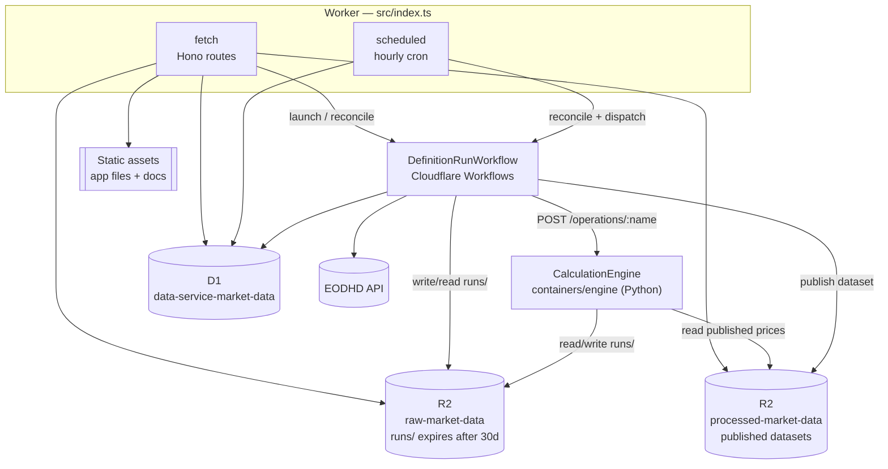
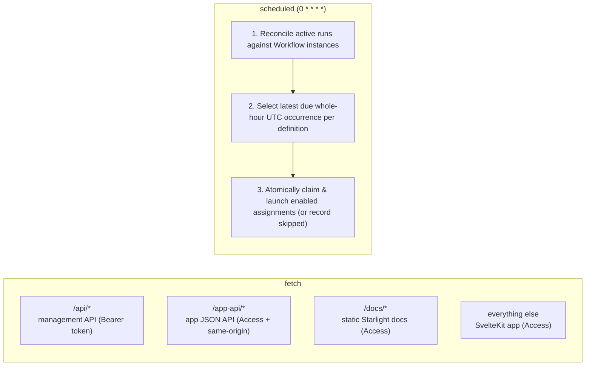

Everything runs on Cloudflare with one workflow execution model and one Python
service. The Worker owns HTTP, scheduling, D1 state transitions, and durable
step orchestration; the single Python container runs stateless data operations
over R2 objects and never touches D1.

For the source-code map, Effect conventions, and how to extend the service, see
[Maintaining the code](/docs/maintaining/).

## Parts

| Part                             | Role                                                                                                                                                                      |
| -------------------------------- | ------------------------------------------------------------------------------------------------------------------------------------------------------------------------- |
| **Worker** (`src/index.ts`)      | Management API (`/api/*`), app JSON API (`/app-api/*`), SvelteKit SSR handler, static docs routing, and the hourly `scheduled` workflow dispatcher.                       |
| **`DefinitionRunWorkflow`**      | Cloudflare Workflow entrypoint. One instance per workflow run (instance ID equals run ID). Executes captured steps sequentially with durable checkpoints and waits.       |
| **`CalculationEngine`**          | Single Durable Object–backed Python container (`containers/engine/`). Serves `GET /health`, `GET /operations`, and `POST /operations/{name}` (normalization, volatility). |
| **App** (`app/`)                 | SvelteKit app behind Cloudflare Access: home overview, assets, portfolios, read-only workflow/run inspection, and Parquet explorer.                                       |
| **D1**                           | Assets, portfolios and dated holdings, workflow definitions, defaults, assignments, operational run/step history, and dataset publication metadata.                       |
| **`raw-market-data`** (R2)       | Temporary run artifacts under `runs/<runId>/<stepId>/` (30-day R2 lifecycle expiry) plus retained pre-workflow raw history (`dataset=.../run=...json`, never expired).    |
| **`processed-market-data`** (R2) | Current published Parquet datasets at stable paths (`dataset=prices_eod/symbol=<SYMBOL>/data.parquet`, `dataset=portfolio_volatility/portfolio=<ID>/data.parquet`).       |

## Entry points

The Worker exports two handlers (`fetch` and `scheduled`), one Workflow class
(`DefinitionRunWorkflow`), and one Container class (`CalculationEngine`):

## Design principles

- **Whole workflow specifications as data.** Definitions are submitted and
  replaced atomically (`POST` / `PUT`) and validated against the code-owned
  step registry before saving. Execution order is the supplied step list, with
  explicit backward-only input/output references.
- **Effect for orchestration, Cloudflare Workflows for durability.** Business
  operations are injectable Effect programs; Cloudflare Workflows provides
  durable checkpoints, bounded retries, and durable sleeps across replays.
- **One Python service, generated contracts.** Pydantic models in
  `containers/engine/` export JSON Schemas that generate the Worker's Effect
  Schemas (`pnpm operations:generate`). Both sides validate at runtime.
- **Current-state inputs and explicit publication.** Steps read current
  holdings and current published datasets without a historical pinning system.
  Temporary artifacts live under `runs/` and expire after 30 days through an R2
  lifecycle rule; published datasets are copied independently to the processed
  bucket so failed runs never corrupt existing consumer data.
- **D1 is the state authority; partial unique indexes enforce concurrency.**
  Python never writes to D1. Partial unique indexes enforce one active run per
  assignment and one run per assignment occurrence.
- **Retained history over destructive cleanup.** Deleting an asset, portfolio,
  or workflow definition is blocked while an active run references it (or while
  portfolio holdings reference an asset); once allowed, deletion removes
  assignments while preserving run records and published datasets.

## Deliberately out of scope

- A drag-and-drop visual workflow builder or user-authored executable code.
- Arbitrary cron expressions, minute schedules, or replaying every missed
  historical occurrence.
- Historical dataset pinning / exact point-in-time dataset reproduction.
- A scheduled cleanup workflow or D1 index for temporary R2 artifacts (handled
  entirely by R2's 30-day prefix lifecycle rule).
- Upstream auto-triggering (dependency steps wait and report missing inputs
  without starting upstream workflows).
