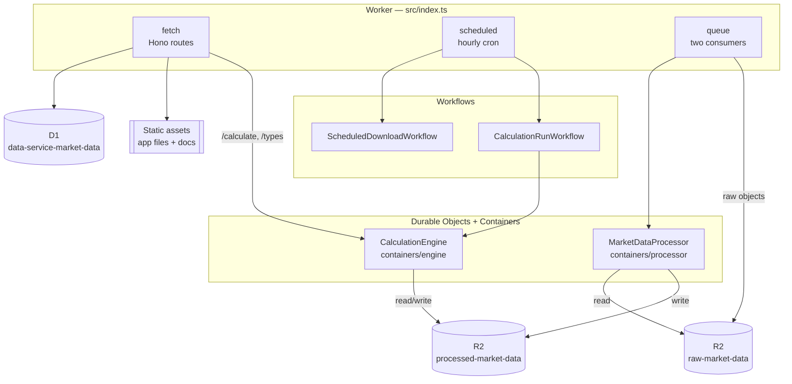
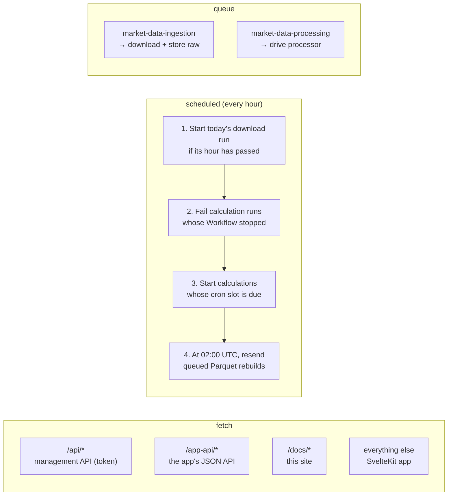

Everything runs on Cloudflare. One Worker (`data-service`) holds all state
transitions; the two Python containers do the heavy data work and never touch
D1.

## Parts

| Part | Role |
| --- | --- |
| **Worker** | Management API, hourly cron, ingestion consumer (provider downloads, raw storage), all D1 state, processing consumer that drives the processor container, and the calculation API that drives the engine container. |
| **`ScheduledDownloadWorkflow`** | One instance per run of the daily schedule. Queues a download for every enabled symbol and records the outcome. |
| **`CalculationRunWorkflow`** | One instance per calculation run. Calls the engine and records the outcome. |
| **App** (`app/`) | SvelteKit app: a home page summing up both pipelines, and the dashboard pages for runs, symbols, the schedule, portfolios, calculations and the Parquet data. Runs inside the Worker, behind Cloudflare Access. See [The app and sign-in](/docs/operations/dashboard/). |
| **D1** | Universe, schedule, runs, jobs, portfolios and calculations. No market data or results. See [Data model](/docs/reference/data-model/). |
| **`raw-market-data`** (R2) | Immutable validated provider responses, one per run. |
| **Processor container** | Reads one raw object, writes one Parquet object, returns its ETag. No D1 access, no callbacks. |
| **Engine container** | Holds every calculation type. Validates params, runs calculations over the canonical Parquet files and writes their results. Reads and writes the processed bucket only. |
| **`processed-market-data`** (R2) | One Parquet object per `(dataset, symbol)`, and one per calculation. This is what apps read. |

## Entry points

The Worker exports three handlers. Each one is a different way work enters the
system:

The steps of the hourly tick fail independently: a failure to start the
download run doesn't stop calculations from being scheduled.

## Design principles

- **Full rebuilds, not deltas.** Every ingestion run is a full-history
  snapshot, and every processing job rebuilds the Parquet file from scratch.
  Retrying or repeating anything is always safe.
- **D1 is the only source of truth for state.** Containers get everything they
  need in the request and report back in the response. They have no callbacks.
- **Partial unique indexes enforce concurrency rules.** One `fetching` run per
  symbol, one active processing job per symbol, one scheduled download run per
  day, one `running` run per calculation.
- **Types live in Python only.** The Worker knows no calculation types; it asks
  the engine for them. A new type needs no TypeScript, migration or dashboard
  change.
- **Apps read R2 directly.** The API manages the universe and calculations; it
  never serves data.

## Deliberately left out

Delta/merge processing, multiple providers for the same `(dataset, symbol)`,
and leases with fencing. Add them only if full rebuilds become too slow or
expensive.

### Not implemented yet

1. **Inspection.** A management endpoint showing each symbol's latest run, job
   status and error.
2. **Raw retention.** Delete raw objects older than N days, except the latest
   completed run per symbol.
3. **Second dataset** (FRED rates).
4. **Deleting tracked symbols.** The registry has no delete route. Whoever adds
   it maps the foreign-key failure for a held symbol to `409` with the
   portfolios holding it (`portfolio_holdings_by_symbol` finds them).
