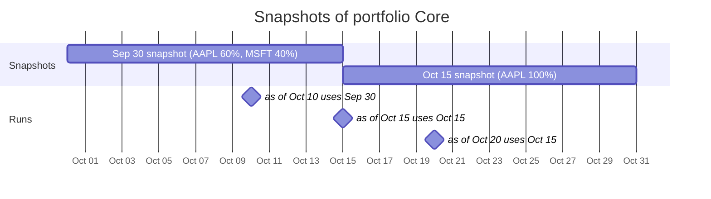
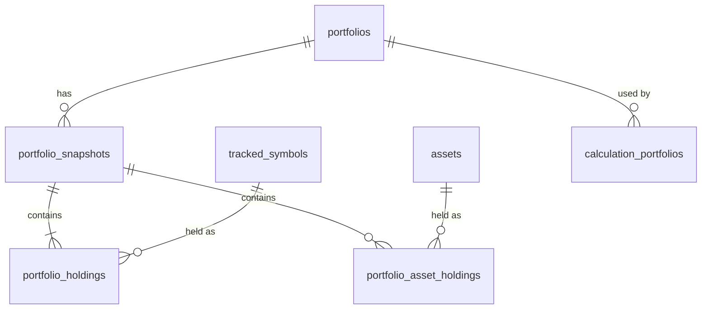

A **portfolio** is a name and a series of **holdings snapshots**. A snapshot is
a holdings date and a list of `(symbol, weight)`: the holdings at the close of
that date. It stays in effect until the next snapshot. The service stores
snapshots, not trades or changes between them.

## Single-asset portfolios

Registering a `prices_eod` symbol also creates a portfolio named after it, with
one snapshot on `1900-01-01` holding the symbol at weight 1, in the same D1
batch as the registration. Re-registering leaves it alone. Migration `0008`
creates these portfolios for symbols registered before the migration.

The API returns `assetSymbol` (the symbol for a single-asset portfolio, `null`
for a normal one). Single-asset portfolios cannot be renamed, deleted or given
other snapshots; those changes return `409`. The app labels them and lets you
hide them from the list.

## Which snapshot is in effect



- A run for as-of date **D** sees the snapshots dated **on or before D**, never
  later ones. A snapshot dated D counts for D itself.
- If a portfolio has no snapshot on or before D, only that portfolio fails; the
  other portfolios of the run still complete.
- Each calculation type picks the snapshots it needs: `holdings_at(date)` for
  one date (ex-ante volatility), or `snapshots_between(start, end)` for every
  snapshot over a period (realised P&L).

## Rules

- **Symbols.** Every symbol must exist as an asset or as a legacy `prices_eod`
  registry entry. Disabled assets can be held. A holding in any of a
  portfolio's snapshots prevents deleting the corresponding asset.
- **Weights.** Any non-zero numbers. Shorts and leverage are allowed, and they
  don't need to sum to 1. Each type normalises or checks them as it needs.
- **One per date.** A portfolio has at most one snapshot per holdings date;
  snapshots are addressed by that date.
- **No edits.** Snapshots can be added or deleted, not edited. To correct one,
  delete it and add it again. Earlier results aren't rewritten; types that
  depend on one snapshot (like `ex_ante_vol`) record its holdings date in their
  results.
- **Deleting.** Deleting a portfolio that a calculation uses returns `409` with
  the calculations that use it. Active workflow runs also block deletion.
  After those runs finish, deleting the portfolio removes its assignments and
  keeps its workflow run history and published datasets.



## API

```sh
# Create one, optionally with its first snapshot
curl -X POST "$URL/api/portfolios" \
  -H "Authorization: Bearer $MANAGEMENT_API_TOKEN" \
  -H 'Content-Type: application/json' \
  -d '{"name":"Core","snapshot":{"holdingsDate":"2026-09-30","holdings":[{"symbol":"AAPL.US","weight":0.6},{"symbol":"MSFT.US","weight":0.4}]}}'

# Add a snapshot, or delete the one for a date
curl -X POST "$URL/api/portfolios/$ID/snapshots" \
  -H "Authorization: Bearer $MANAGEMENT_API_TOKEN" \
  -H 'Content-Type: application/json' \
  -d '{"holdingsDate":"2026-10-15","holdings":[{"symbol":"AAPL.US","weight":1}]}'
curl -X DELETE "$URL/api/portfolios/$ID/snapshots/2026-10-15" -H "Authorization: Bearer $MANAGEMENT_API_TOKEN"
```

New portfolios get the portfolio workflow defaults in effect at creation.
Assign additional definitions with the workflow assignment API. The app's
portfolio detail shows the dated holdings and assigned workflows.

To inspect a fixture portfolio, run `pnpm workflow:fixture` and open
`.local/workflow-fixture/portfolio.json`.

The full route list is in the
[API reference](/docs/reference/api/#portfolios).
