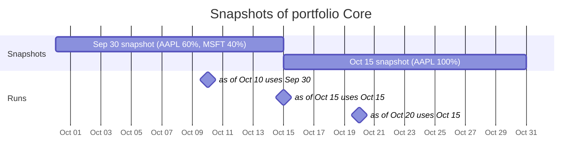
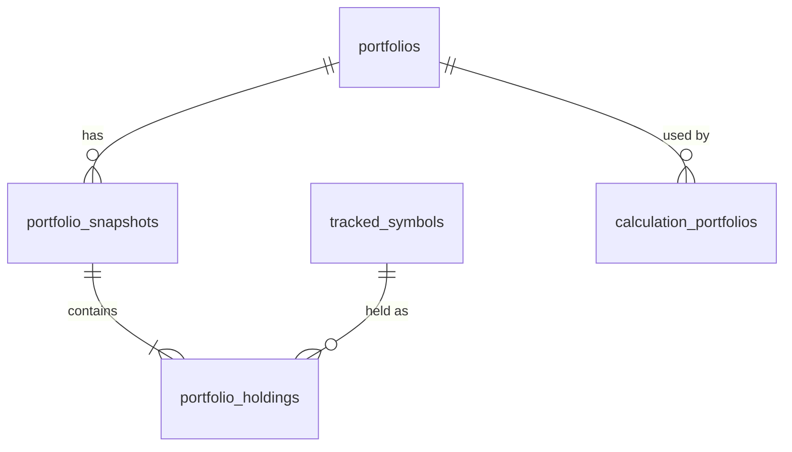

A **portfolio** is a name and a series of **holdings snapshots**. A snapshot is
a holdings date and a list of `(symbol, weight)`: the holdings at the close of
that date. It stays in effect until the next snapshot. The service stores
snapshots, not trades or changes between them.

## Which snapshot is in effect



- A run for as-of date **D** sees the snapshots dated **on or before D**, never
  later ones. A snapshot dated D counts for D itself.
- If a portfolio has no snapshot on or before D, only that portfolio fails; the
  other portfolios of the run still complete.
- Each calculation type picks the snapshots it needs: `holdings_at(date)` for
  one date (ex-ante volatility), or `snapshots_between(start, end)` for every
  snapshot over a period (realised P&L).

## Rules

- **Symbols.** Every symbol must be a tracked symbol in `prices_eod` (disabled
  symbols count). A foreign key from holdings to `tracked_symbols` keeps a held
  symbol from being deleted.
- **Weights.** Any non-zero numbers. Shorts and leverage are allowed, and they
  don't need to sum to 1. Each type normalises or checks them as it needs.
- **One per date.** A portfolio has at most one snapshot per holdings date;
  snapshots are addressed by that date.
- **No edits.** Snapshots can be added or deleted, not edited. To correct one,
  delete it and add it again. Earlier results aren't rewritten; types that
  depend on one snapshot (like `ex_ante_vol`) record its holdings date in their
  results.
- **Deleting.** Deleting a portfolio that a calculation uses returns `409` with
  the calculations that use it. Disabling a held symbol is allowed: its Parquet
  file stays, so calculations keep working on its old data.



## API

```sh
# Create one, optionally with its first snapshot
curl -X POST "$URL/portfolios" \
  -H "Authorization: Bearer $MANAGEMENT_API_TOKEN" \
  -H 'Content-Type: application/json' \
  -d '{"name":"Core","snapshot":{"holdingsDate":"2026-09-30","holdings":[{"symbol":"AAPL.US","weight":0.6},{"symbol":"MSFT.US","weight":0.4}]}}'

# Add a snapshot, or delete the one for a date
curl -X POST "$URL/portfolios/$ID/snapshots" \
  -H "Authorization: Bearer $MANAGEMENT_API_TOKEN" \
  -H 'Content-Type: application/json' \
  -d '{"holdingsDate":"2026-10-15","holdings":[{"symbol":"AAPL.US","weight":1}]}'
curl -X DELETE "$URL/portfolios/$ID/snapshots/2026-10-15" -H "Authorization: Bearer $MANAGEMENT_API_TOKEN"
```

Untracked symbols return `400` with their list in `symbols`; a second snapshot
for the same date returns `409`. The full route list is in the
[API reference](/docs/reference/api/#portfolios).
