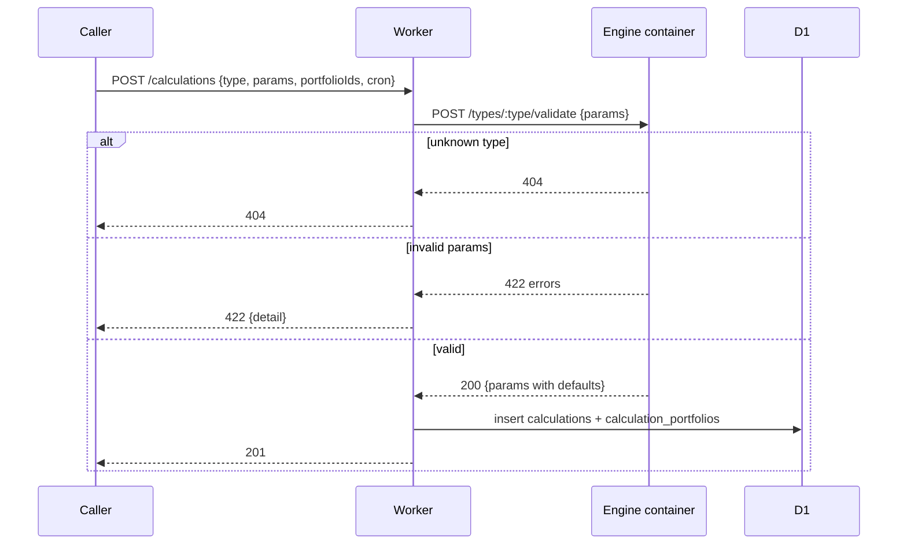
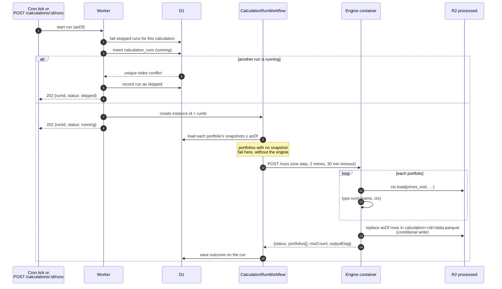
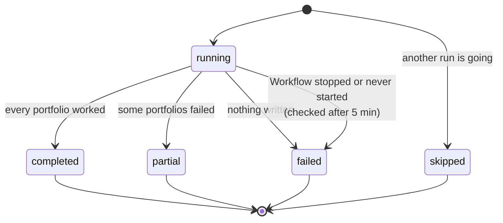
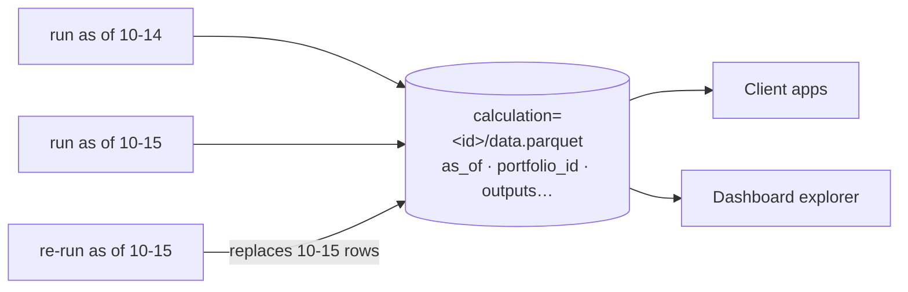
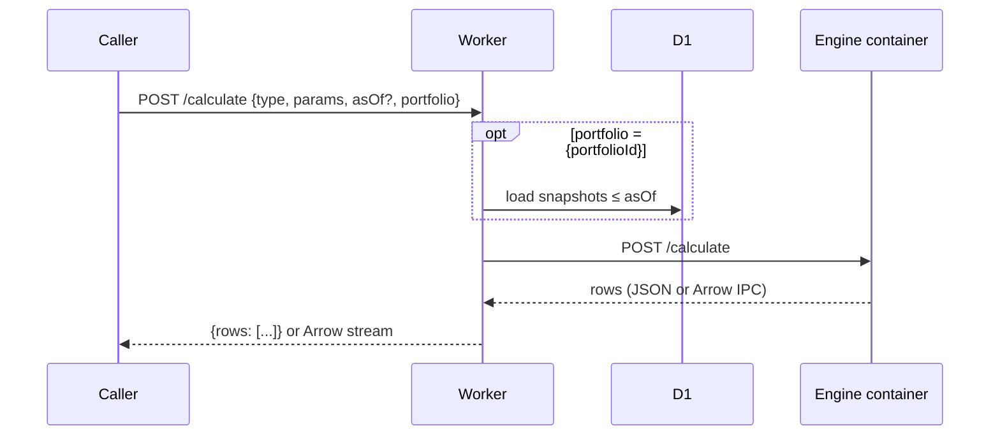

A **calculation** is a saved configuration:

- a calculation type (fixed once created; create a new calculation instead);
- params (JSON, validated by the engine, stored with defaults filled in);
- a list of portfolio IDs, for types that take a portfolio;
- a cron expression (UTC);
- an enabled flag.

Params, portfolios and cron can change. Earlier results are not rewritten, and
each run saves the params it used.

## Creating one

The Worker knows no calculation types. It asks the engine for them and lets
the engine validate params:



## How a run executes

A run is one execution for one **as-of date**. Each run is a
`CalculationRunWorkflow` instance whose ID is the run ID.



### Why a Workflow, not a queue

A Workflow step has no wall-clock limit, while a queue consumer has 15
minutes, and engine runs can be long. One instance per run is also
addressable by run ID, so the Worker can check whether a run is still alive.
The engine step can retry safely because a run replaces its as-of date's rows.

### Run states



- **One at a time.** The partial unique index `calculation_runs_one_running`
  allows one `running` run per calculation. A run started meanwhile is
  recorded as `skipped`.
- **Several portfolios.** A type that takes a portfolio runs once per
  portfolio. If one fails, the others still complete and the run is `partial`,
  with an error for each portfolio that failed.
- **Stuck runs.** A run `running` for over 5 minutes is checked against its
  Workflow. If the Workflow has errored, been terminated, finished without
  recording, or never started, the run is marked failed. This happens on every
  hourly tick and before each new run of the calculation, so a crash can't
  block later runs.

## Results

Each calculation has one Parquet file:

```txt
processed-market-data/calculation=<calculation-id>/data.parquet
```

It holds the type's output columns plus `as_of` and `portfolio_id`, so it
builds a history over time. A run replaces its own as-of date's rows, so
running the same date again is safe. New output columns are added with nulls
for older rows. Results stay in R2 after the calculation is deleted.



## Ad hoc calculations

`POST /calculate` runs a type once and returns the result without saving
anything, with a timeout of about 60 seconds.



`portfolio` is a saved portfolio (`{"portfolioId": …}`) or plain
`{"holdings": [...]}`, which count as held at all times, so other apps can
calculate for portfolios the service doesn't store. `asOf` defaults to the
previous UTC day. Send `Accept: application/vnd.apache.arrow.stream` for Arrow.

| Status | When |
| --- | --- |
| `200` | Rows returned |
| `404` | Unknown type |
| `422` | Invalid params, or an expected failure such as missing prices |
| `500` | Any other failure |
