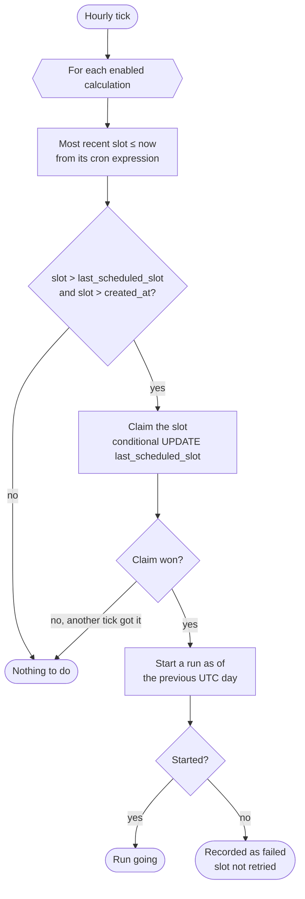
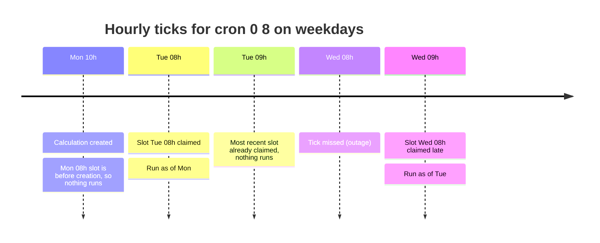

Each calculation has a standard 5-field cron expression in **UTC**. There is no
separate scheduler: the Worker's existing hourly cron checks every calculation.

## Cron slots

A **slot** is a whole UTC hour the expression fires in. Because the tick runs
hourly, the **minute field has no effect** and the finest resolution is one
hour. Monthly calculations are just a cron expression.

On each tick, after the download trigger and the stuck-run check:



- **Missed slots run once.** Each calculation stores the last slot it ran for
  (`last_scheduled_slot`). If the tick missed several slots, only the most
  recent one runs; missed slots are not replayed.
- **At most once per slot.** The tick claims a slot with a conditional update
  before starting the run, so a slot runs at most once even if the tick fires
  twice.
- **New and paused calculations.** A new calculation doesn't run for slots
  before its creation. A paused calculation catches up its latest slot once
  when it's enabled again.

## Example

A calculation with cron `0 8 * * 1-5` (08:00 UTC on weekdays), created on a
Monday at 10:00:



## The as-of date

A scheduled run calculates as of the **previous UTC day**, using whatever
canonical data exists when it starts. It doesn't wait for that day's
downloads, so **schedule calculations a few hours after the download hour**.

```mermaid
gantt
  dateFormat HH:mm
  axisFormat %H:%M
  title A good daily layout (UTC)
  section Market data
  Daily download run starts (hour 06) :milestone, 06:00, 0m
  Downloads + Parquet rebuilds :active, 06:00, 90m
  section Calculations
  Calculation slot (0 9 * * *) :milestone, 09:00, 0m
  Run as of yesterday :09:00, 30m
```



To fill in a past date, use run now with an `asOf`:

```sh
curl -X POST "$URL/api/calculations/$ID/runs" -H "Authorization: Bearer $MANAGEMENT_API_TOKEN" \
  -H 'Content-Type: application/json' -d '{"asOf":"2026-10-16"}'
```
