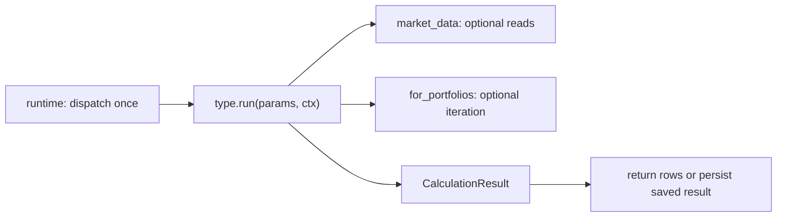

Add one module to `containers/engine/src/data_service_engine/types/` that exports
`TYPE = CalculationType(...)`. The registry discovers it automatically. The
Worker and dashboard use its metadata and parameter schema; they do not need
code for each individual type.

Every request invokes **`run(params, ctx)` exactly once**, with all its inputs.
The calculation chooses what to load, whether to iterate, and what to aggregate.
The runtime dispatches the request and, for saved runs, persists the result.



## A complete portfolio example

This example counts canonical price rows for each portfolio over a calendar
lookback. Each computation receives its portfolio explicitly; the outer `run`
chooses to share data access across independent portfolio computations.

```python
from datetime import timedelta

import polars as pl
from pydantic import BaseModel, ConfigDict, Field

from ..framework import CalculationResult, CalculationType, Context
from ..market_data import MarketData, market_data
from ..models import Portfolio
from ..portfolio_calculations import for_portfolios

NAME = "price_coverage"
OUTPUT = {"price_rows": pl.Int64}


class Params(BaseModel):
    model_config = ConfigDict(extra="forbid")
    lookback_days: int = Field(30, ge=1)


def calculate_portfolio(
    params: Params, data: MarketData, portfolio: Portfolio
) -> pl.DataFrame:
    snapshot = portfolio.holdings_at(data.as_of)
    prices = data.load(
        "prices_eod",
        snapshot.symbols,
        start=data.as_of - timedelta(days=params.lookback_days),
    )
    return prices.select(pl.len().alias("price_rows"))


def run(params: Params, ctx: Context) -> CalculationResult:
    with market_data(ctx.as_of, ctx.load_symbol) as data:
        return for_portfolios(
            ctx,
            OUTPUT,
            lambda portfolio: calculate_portfolio(params, data, portfolio),
            name=NAME,
        )


TYPE = CalculationType(
    name=NAME,
    description="Canonical price row counts for calculation-date holdings.",
    params=Params,
    output=OUTPUT,
    run=run,
    takes_portfolio=True,
)
```

`ex_ante_vol.py` and `hypothetical_portfolio_returns.py` follow this same flow.
Registration appears last because it needs the parameter model and functions.
Modules starting with `_` are skipped; duplicate type names are rejected.

## Contracts and ownership

| Contract                          | Meaning                                                                                                                                                                   |
| --------------------------------- | ------------------------------------------------------------------------------------------------------------------------------------------------------------------------- |
| `Context.as_of`                   | Calculation date. Pass it to data and holdings helpers to enforce the cutoff.                                                                                             |
| `Context.portfolios`              | All resolved selections in input order. The framework does not iterate or remove future snapshots.                                                                        |
| `Context.mode`                    | Caller policy: `saved`, synchronous `single`, or synchronous `batch`. Helpers can preserve the appropriate error behavior.                                                |
| `Context.load_symbol`             | Optional test loader, passed to `market_data`. Production leaves it unset.                                                                                                |
| `CalculationResult.rows`          | Complete result frame, including any identifying columns owned by the calculation.                                                                                        |
| `CalculationResult.status`        | `completed`, `partial`, or `failed`. Saved runs write completed/partial results; synchronous calls require completed results.                                             |
| `CalculationResult.error`         | Optional execution-level failure message.                                                                                                                                 |
| `CalculationResult.portfolios`    | Optional portfolio outcomes. Symbol and aggregate calculations can leave this empty.                                                                                      |
| `CalculationType.params`          | Pydantic model for validation, defaults and published JSON Schema.                                                                                                        |
| `CalculationType.output`          | Required value columns and their Polars types. The framework checks their presence, strictly casts them and stamps `as_of`. Additional identifying columns are preserved. |
| `CalculationType.takes_portfolio` | Catalog/UI hint that the type uses portfolio input. It does not trigger loops, holdings filtering or data access in the engine. The type enforces its input requirements. |

## Data helpers

`market_data(ctx.as_of, ctx.load_symbol)` is a context manager. Call it inside
any calculation that needs canonical datasets. It opens a storage connection,
creates a lazy symbol cache and closes the connection on exit, including when
the calculation raises. A calculation that never calls it requires no read
connection or R2 configuration for synchronous execution.

`data.load(dataset, symbols, start=None, end=None)` returns dataset columns plus
`symbol`, sorted by symbol and date. Bounds are inclusive; the end is always
clamped to `data.as_of`. Repeated reads in one production scope load each
`(dataset, symbol)` object once. Open the scope outside a portfolio loop to
share those reads. An injected loader bypasses production settings and storage;
the caller controls caching for that loader.

`price_returns(data, symbols, price_start=None)` shares adjusted-close alignment
and return arithmetic across types. It does not select holdings or aggregate
weights. See [Hypothetical portfolio returns](/docs/calculations/returns/) for
the date-gap and alignment rules.

These helpers read the current canonical objects with date cutoffs. They do
not reconstruct the versions of those objects that existed historically.

## Portfolio helpers

Call `for_portfolios` when each selection should produce independent results.
It requires at least one portfolio and passes each computation a copy filtered
to snapshots on/before `ctx.as_of`. It validates the computation's exact output
columns and casts them before attaching `portfolio_id`; synchronous batches also
receive a zero-based `portfolio_index`, so duplicate IDs remain distinct.

The callback chooses the holdings it needs:

- `portfolio.holdings_at(day)` selects the snapshot in effect at that close.
- `portfolio.snapshots_between(start, end)` selects every snapshot in effect
  during the interval, including the one effective at its start.
- `portfolio.holdings_df(start, end)` provides those sets as `holdings_date`,
  `symbol`, `weight` rows.
- `portfolio.symbols` lists all symbols in the supplied snapshots.

These selections represent complete holdings, not trades. The helper rejects
portfolios with no eligible snapshot; inline holdings use one undated snapshot.

## Other calculation shapes

A symbol calculation can declare symbols in its parameter model and read them
directly. This entry point would register `last_price_date` as its output and
leave `takes_portfolio=False`:

```python
class Params(BaseModel):
    model_config = ConfigDict(extra="forbid")
    symbols: list[str] = Field(min_length=1)


def run(params: Params, ctx: Context) -> CalculationResult:
    with market_data(ctx.as_of, ctx.load_symbol) as data:
        rows = (
            data.load("prices_eod", params.symbols)
            .group_by("symbol")
            .agg(pl.col("date").max().alias("last_price_date"))
            .sort("symbol")
        )
    return CalculationResult(rows)
```

An aggregate calculation can consume all selections together without calling
`for_portfolios`. For example, a type with `portfolio_count` as its output can
return one row, with no data reads or per-portfolio result identifiers:

```python
def run(params: Params, ctx: Context) -> CalculationResult:
    return CalculationResult(
        pl.DataFrame({"portfolio_count": [len(ctx.portfolios)]})
    )
```

Neither shape requires a new runtime branch. An aggregate needing prices can
call the same `market_data` and `price_returns` helpers itself.

## Errors

Raise `CalculationError` from `errors.py` for expected failures, like insufficient
history. Its message is shown as supplied; unexpected exceptions include their
type. The portfolio helper applies these existing transport policies:

- Saved runs collect outcomes and retain successful rows. Any failures make
  the result partial; if all fail, no rows are persisted.
- Synchronous batches fail atomically with the input index and portfolio ID.
  Expected failures return 422; unexpected failures return 500.
- Legacy synchronous single-portfolio calls return 500 when computation fails;
  missing required input and invalid parameters return 422.

Failures outside the loop, such as opening the storage connection, are request
failures and do not identify an individual portfolio. A type using its own flow
owns its failure policy; the generic runtime records saved-run exceptions as
failed results and refuses partial synchronous results.

## Checking your type

```sh
cd containers/engine
uv run engine types
uv run engine run request.json
uv run pytest
```

For numerical tests, call `TYPE.calculate(params, Context(as_of, portfolios,
load_symbol=reader))` with a local loader. Test data selection, date cutoffs and
arithmetic through the same helpers production uses. Engine HTTP tests also
exercise symbol results, aggregate execution, partial saved runs and atomic
portfolio batches.

From the repo root, `pnpm engine:test` and `pnpm engine:lint` run the CI checks.
If a type is removed, saved calculations still exist but their runs fail.
