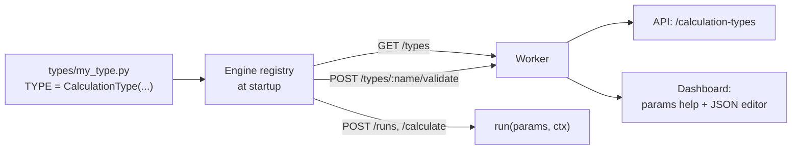
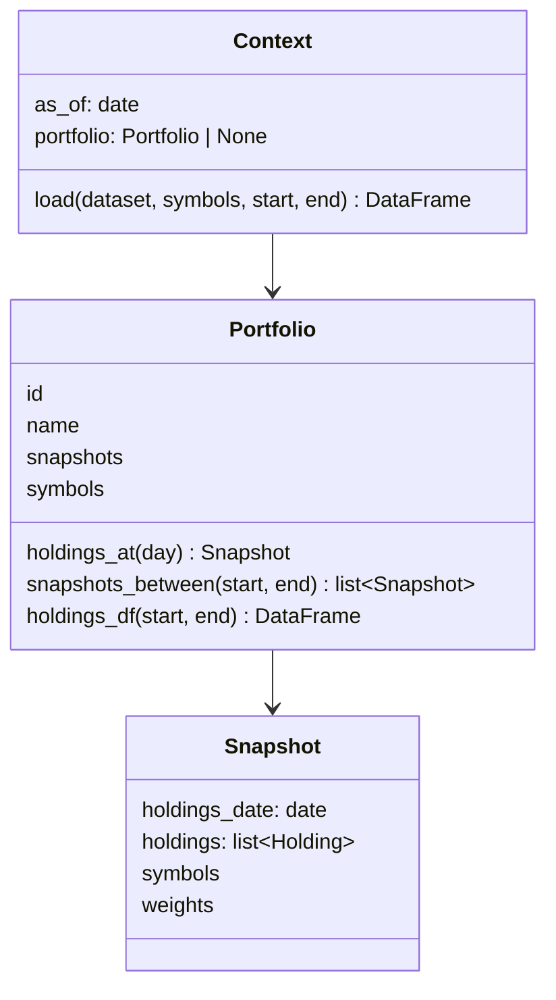

The goal of the engine is that **adding a calculation type is one Python
file**. The Worker, D1 and the dashboard don't know about individual types: a
new type needs no TypeScript, migration or dashboard change, just a new module
and a redeploy.



## The module

Add one module to `containers/engine/src/data_service_engine/types/` that
defines `TYPE = CalculationType(...)`:

```python
class Params(BaseModel):
    model_config = ConfigDict(extra="forbid")
    window: int = Field(252, ge=2)


def run(params: Params, ctx: Context) -> pl.DataFrame:
    snapshot = ctx.portfolio.holdings_at(ctx.as_of)
    prices = ctx.load("prices_eod", snapshot.symbols, start=...)
    return pl.DataFrame({"value": [...]})


TYPE = CalculationType(
    name="my_type",
    description="What it calculates.",
    params=Params,
    output={"value": pl.Float64},
    run=run,
    takes_portfolio=True,
)
```

| Field | Meaning |
| --- | --- |
| `name` | The type's ID, such as `ex_ante_vol`. Two types with the same name stop the engine from starting. |
| `params` | A Pydantic model. `GET /types` publishes its JSON Schema, and the Worker stores params as plain JSON. |
| `output` | The columns `run` returns, in order. The framework checks them, casts to these types and adds `as_of` and `portfolio_id`. `run` may return any number of rows. |
| `takes_portfolio` | `True` runs the type once per portfolio. Otherwise it runs once with `ctx.portfolio` set to `None`. |
| `run` | `run(params, ctx) -> pl.DataFrame` |

Modules starting with `_` are skipped, so shared helpers can live there.

## What `ctx` gives you



- **`ctx.as_of`** is the date being calculated.
- **`ctx.load(dataset, symbols, start, end)`** returns a polars DataFrame of the
  dataset's rows with a `symbol` column, read from the canonical Parquet files.
  It **never returns rows after `ctx.as_of`**.
- **`ctx.portfolio`** holds every holdings snapshot up to `ctx.as_of`. A
  snapshot is the holdings at the close of its `holdings_date`, in effect until
  the next one:
  - `holdings_at(day)`: the snapshot in effect at the close of `day`.
  - `snapshots_between(start, end)`: every snapshot in effect at some close in
    the period, starting with the one in effect at `start`.
  - `holdings_df(start, end)`: the same as `holdings_date`, `symbol`, `weight`
    rows, for joining with prices.
  - `symbols`: every symbol held in any snapshot.

Types never call R2 or providers directly. They can only read datasets, not
other calculations' results.

## Errors

Raise `CalculationError` for expected failures, like missing data. Its message
is shown as is on the run (per portfolio) or in the ad hoc response's `422`.
Other exceptions show their type too.

## Checking your type

```sh
cd containers/engine
uv run engine types               # list types and their params schemas
uv run engine run request.json    # one run request, prints the result
uv run pytest
```

From the repo root, `pnpm engine:test` and `pnpm engine:lint` run the same
checks as CI. If a type is removed from the code, calculations that use it
still exist, but their runs fail.
