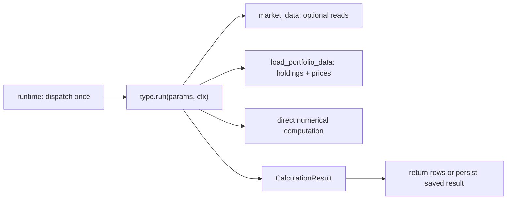

Add one module to `containers/engine/src/data_service_engine/types/` that exports
`TYPE = CalculationType(...)`. The registry discovers it automatically. The
Worker and dashboard use its metadata and parameter schema; they do not need
code for each individual type.

Every request invokes **`run(params, ctx)` exactly once**, with all its inputs.
The calculation chooses what to load, whether to iterate, and what to aggregate.
The runtime dispatches the request and, for saved runs, persists the result.



## A complete portfolio example

This example counts canonical price rows for each portfolio over a calendar
lookback. `run` loads the inputs, calculates directly and handles errors in an
ordinary loop. There is no callback-based execution wrapper.

```python
from datetime import timedelta

import polars as pl
from pydantic import BaseModel, ConfigDict, Field

from ..errors import BatchCalculationFailed, CalculationError, describe_error
from ..framework import CalculationResult, CalculationType, Context
from ..market_data import load_portfolio_data, market_data
from ..models import PortfolioOutcome
from ..portfolio_results import portfolio_result, portfolio_rows

NAME = "price_coverage"
OUTPUT = {"price_rows": pl.Int64}


class Params(BaseModel):
    model_config = ConfigDict(extra="forbid")
    lookback_days: int = Field(30, ge=1)


def run(params: Params, ctx: Context) -> CalculationResult:
    if not ctx.portfolios:
        raise CalculationError(f"{NAME} needs at least one portfolio")
    start = ctx.as_of - timedelta(days=params.lookback_days)
    frames, outcomes = [], []
    with market_data(ctx.as_of, ctx.load_symbol) as data:
        for index, portfolio in enumerate(ctx.portfolios):
            try:
                inputs = load_portfolio_data(portfolio, data, start=start)
                rows = inputs.prices.select(pl.len().alias("price_rows"))
                rows = portfolio_rows(
                    rows,
                    OUTPUT,
                    portfolio.id,
                    index=index if ctx.mode == "batch" else None,
                )
            except Exception as error:
                if ctx.mode == "batch":
                    raise BatchCalculationFailed(index, portfolio.id, error) from error
                outcomes.append(PortfolioOutcome(
                    portfolio_id=portfolio.id,
                    status="failed",
                    error=describe_error(error),
                ))
                continue
            frames.append(rows)
            outcomes.append(PortfolioOutcome(
                portfolio_id=portfolio.id,
                status="completed",
                row_count=rows.height,
            ))
    return portfolio_result(frames, outcomes, OUTPUT, indexed=ctx.mode == "batch")


TYPE = CalculationType(
    name=NAME,
    description="Canonical price row counts for calculation-date holdings.",
    params=Params,
    output=OUTPUT,
    run=run,
    takes_portfolio=True,
)
```

`ex_ante_vol.py` and `hypothetical_portfolio_returns.py` follow this same flow.
Registration appears last because it needs the parameter model and functions.
Modules starting with `_` are skipped; duplicate type names are rejected.

## Contracts and ownership

| Contract                          | Meaning                                                                                                                                                                   |
| --------------------------------- | ------------------------------------------------------------------------------------------------------------------------------------------------------------------------- |
| `Context.as_of`                   | Calculation date. Pass it to data and holdings helpers to enforce the cutoff.                                                                                             |
| `Context.portfolios`              | All resolved selections in input order. The framework does not iterate or remove future snapshots.                                                                        |
| `Context.mode`                    | Caller policy: `saved`, synchronous `single`, or synchronous `batch`. Each calculation implements its error handling explicitly.                                          |
| `Context.load_symbol`             | Optional test loader, passed to `market_data`. Production leaves it unset.                                                                                                |
| `CalculationResult.rows`          | Complete result frame, including any identifying columns owned by the calculation.                                                                                        |
| `CalculationResult.status`        | `completed`, `partial`, or `failed`. Saved runs write completed/partial results; synchronous calls require completed results.                                             |
| `CalculationResult.error`         | Optional execution-level failure message.                                                                                                                                 |
| `CalculationResult.portfolios`    | Optional portfolio outcomes. Symbol and aggregate calculations can leave this empty.                                                                                      |
| `CalculationType.params`          | Pydantic model for validation, defaults and published JSON Schema.                                                                                                        |
| `CalculationType.output`          | Required value columns and their Polars types. The framework checks their presence, strictly casts them and stamps `as_of`. Additional identifying columns are preserved. |
| `CalculationType.takes_portfolio` | Catalog/UI hint that the type uses portfolio input. It does not trigger loops, holdings filtering or data access in the engine. The type enforces its input requirements. |

## Data helpers

`market_data(ctx.as_of, ctx.load_symbol)` is a context manager. Call it inside
any calculation that needs canonical datasets. It opens a storage connection,
creates a lazy symbol cache and closes the connection on exit, including when
the calculation raises. A calculation that never calls it requires no read
connection or R2 configuration for synchronous execution.

`data.load(dataset, symbols, start=None, end=None)` returns dataset columns plus
`symbol`, sorted by symbol and date. Bounds are inclusive; the end is always
clamped to `data.as_of`. Repeated reads in one production scope load each
`(dataset, symbol)` object once. Open the scope outside a portfolio loop to
share those reads. An injected loader bypasses production settings and storage;
the caller controls caching for that loader.

`load_portfolio_data(portfolio, data, start=None)` returns an ordinary
`PortfolioData` value with:

- `as_of`: the reader's calculation date;
- `holdings`: the snapshot effective on that date, including its unchanged weights;
- `prices`: raw canonical rows for those symbols, from `start` through `as_of`.

The input portfolio is a resolved saved history or an inline composition. Saved
portfolio IDs are looked up by the Worker, which owns D1. The helper selects the
as-of holdings before requesting any prices, so future holdings never add symbols
to the read. It does not iterate, execute callbacks, tag results or handle errors.
A returned `PortfolioData` owns no connection and can be passed to numerical code.

`price_returns(prices, symbols)` aligns the already-loaded adjusted-close rows
and calculates unweighted asset returns. It performs no I/O. Types apply their
own weights, date filters and statistics afterward. Keep a preceding price row
when filtering return observation dates. See
[Hypothetical portfolio returns](/docs/calculations/returns/) for alignment and
date-gap rules.

These helpers read the current canonical objects with date cutoffs. They do
not reconstruct the versions of those objects that existed historically.

## Portfolio results

The calculation owns its loop, input checks and `try`/`except` blocks. It can
process selections independently or use them together in an aggregate.

Two functional helpers handle completed data:

- `portfolio_rows(rows, output, portfolio_id, index=None)` validates the exact
  value-column schema, casts it and adds identifiers. Supplying an index adds
  `portfolio_index`, distinguishing repeated saved IDs and inline compositions.
- `portfolio_result(frames, outcomes, output, indexed=False)` combines frames
  and summarizes already-recorded outcomes. All-failed results retain a typed
  empty frame. It does not run code, load data or catch exceptions.

For period-based calculations that need several holdings snapshots, query the
supplied composition directly with `portfolio.holdings_at(day)`,
`snapshots_between(start, end)` or `holdings_df(start, end)`. The generic framework
does not filter the whole history; the calculation chooses the appropriate
cutoff. The built-in types use the single as-of snapshot returned by the data
helper. Inline holdings use one undated snapshot.

## Other calculation shapes

A symbol calculation can declare symbols in its parameter model and read them
directly. This entry point would register `last_price_date` as its output and
leave `takes_portfolio=False`:

```python
class Params(BaseModel):
    model_config = ConfigDict(extra="forbid")
    symbols: list[str] = Field(min_length=1)


def run(params: Params, ctx: Context) -> CalculationResult:
    with market_data(ctx.as_of, ctx.load_symbol) as data:
        rows = (
            data.load("prices_eod", params.symbols)
            .group_by("symbol")
            .agg(pl.col("date").max().alias("last_price_date"))
            .sort("symbol")
        )
    return CalculationResult(rows)
```

An aggregate calculation can consume all selections together in its own code. For example, a type with `portfolio_count` as its output can
return one row, with no data reads or per-portfolio result identifiers:

```python
def run(params: Params, ctx: Context) -> CalculationResult:
    return CalculationResult(
        pl.DataFrame({"portfolio_count": [len(ctx.portfolios)]})
    )
```

Neither shape requires a new runtime branch. An aggregate needing prices can
call `load_portfolio_data` for its selections and combine them as needed, or
read symbols directly through `data.load`.

## Errors

Raise `CalculationError` from `errors.py` for expected failures, like insufficient
history. Its message is shown as supplied; unexpected exceptions include their
type. The built-in calculations implement these transport policies explicitly:

- Saved runs collect outcomes and retain successful rows. Any failures make
  the result partial; if all fail, no rows are persisted.
- Synchronous batches fail atomically with the input index and portfolio ID.
  Expected failures return 422; unexpected failures return 500.
- Legacy synchronous single-portfolio calls return 500 when computation fails;
  missing required input and invalid parameters return 422.

Failures outside the loop, such as opening the storage connection, are request
failures and do not identify an individual portfolio. A type using its own flow
owns its failure policy; the generic runtime records saved-run exceptions as
failed results and refuses partial synchronous results.

## Checking your type

```sh
cd containers/engine
uv run engine types
uv run engine run request.json
uv run pytest
```

For numerical tests, call `TYPE.calculate(params, Context(as_of, portfolios,
load_symbol=reader))` with a local loader. Test data selection, date cutoffs and
arithmetic through the same helpers production uses. Engine HTTP tests also
exercise symbol results, aggregate execution, partial saved runs and atomic
portfolio batches.

From the repo root, `pnpm engine:test` and `pnpm engine:lint` run the CI checks.
If a type is removed, saved calculations still exist but their runs fail.
