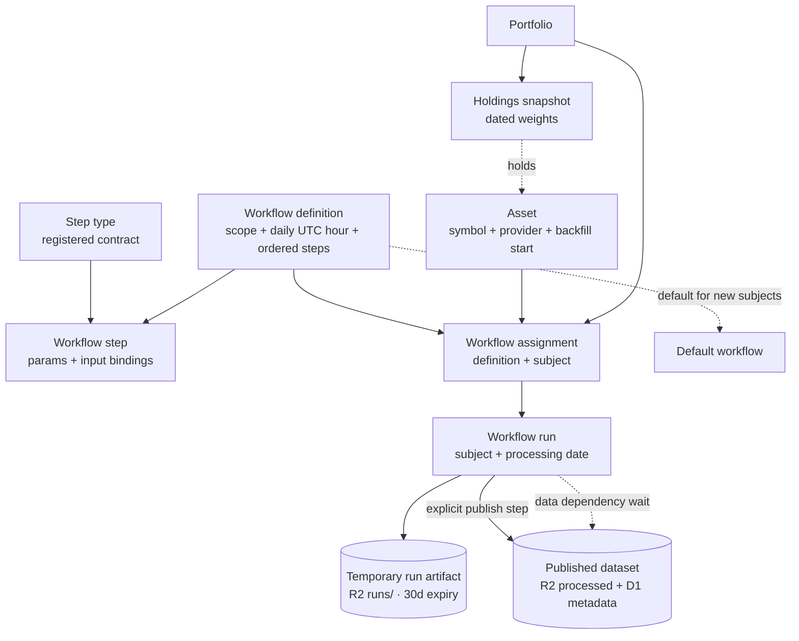

The words below match `CONTEXT.md` and have precise meanings in the code, the
API, and the app.

## Subjects and data

### Asset

An instrument identified by its provider-qualified symbol (such as `AAPL.US` or
`BRK-B.US`), independently of the datasets produced for it. Creating an asset
records its `provider`, `backfillStartDate`, and `enabled` flag, assigns any
asset default workflows, and creates no synthetic portfolio.

### Portfolio

A named collection of dated **holdings snapshots**. One snapshot represents
constant holdings from its `holdingsDate` until a later snapshot takes effect.

### Holdings snapshot

The complete list of `(symbol, weight)` pairs held in a portfolio at the close
of an effective date. Snapshots are added or deleted, never edited in place.
Every symbol in a new snapshot must be a registered asset.

### Subject

The asset or portfolio for which a workflow runs or a dataset is published.

### Dataset

A named kind of data associated with an asset or portfolio, such as
`prices_eod` (daily asset prices) or `portfolio_volatility`. The dataset name
and subject identify its current published Parquet object.

## Workflows and execution

### Workflow definition

A complete specification stored as data: a `name`, a `scope` (`asset` or
`portfolio`), an `enabled` flag, a daily whole-hour UTC `schedule` (`hourUtc`),
and an ordered list of uniquely identified **workflow steps** with explicit
input/output bindings.

### Step type

A predefined operation registered in TypeScript (`src/workflows/registry/`),
with declared compatible scopes, parameter schema, named inputs and outputs,
and explicit contract identities (such as `download-prices`,
`normalize-prices`, `portfolio-holdings`, `wait-for-asset-publications`,
`calculate-portfolio-volatility`, or `publish-dataset`).

### Workflow step

One configured occurrence of a step type inside a workflow definition, with a
unique `id`, literal `params`, and `inputs` bound to literals, run-context
fields (`context.subject`, `context.processingDate`), or earlier step outputs
(`steps.<id>.outputs.<name>`).

### Workflow assignment

An individually enabled or disabled association of one workflow definition with
one asset or portfolio of the matching scope.

### Default workflow

A workflow definition assigned automatically when a new subject of its kind is
created. Changing defaults affects future subjects only; applying defaults to
existing subjects is an explicit, idempotent API call that never re-enables
disabled assignments.

### Workflow run

One execution of a workflow definition for one assigned subject and one
**processing date**. The definition's steps are captured once when the run is
claimed. Only one run per assignment may be active (`queued`, `running`, or
`waiting`) at a time.

### Processing date

The `YYYY-MM-DD` UTC calendar date for which a run performs work and checks
upstream processing success. It does not assert that source data contains an
observation on that exact calendar day (for example, weekends or market
holidays).

### Schedule occurrence

One daily due timestamp of a workflow definition (`YYYY-MM-DDTHH:00:00.000Z`).
Each hourly tick dispatches only the latest due occurrence per enabled
assignment and never replays older missed occurrences.

### Data dependency

An explicit requirement for upstream data and dated processing success, checked
by a workflow step (`wait-for-asset-publications`) that sleeps durably and
rechecks within a bounded timeout without ever launching upstream workflows.

## Artifacts and publication

### Artifact

Persisted data produced or consumed by a step. Temporary run artifacts live
under `runs/<runId>/<stepId>/<name>.<ext>` in the raw R2 bucket and expire
automatically after 30 days.

### Artifact reference

A small JSON descriptor (`id`, `format`, `schema`) passed between steps through
durable checkpoints instead of copying large payloads through workflow state.

### Publication

The explicit step (`publish-dataset`) and recorded D1 metadata that copies a
validated artifact to its independent, stable location in the processed R2
bucket. Published datasets survive temporary artifact expiration and allowed
configuration deletion.
