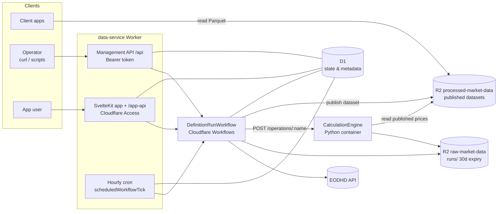

import { Card, CardGrid, LinkCard } from "@astrojs/starlight/components";

A personal market-data and portfolio workflow service on Cloudflare Workers. It
stores whole **workflow definitions** as data, runs their ordered steps with
Effect inside **Cloudflare Workflows**, calls one **Python operation service**
for normalization and numerical work, and explicitly publishes Parquet datasets
to R2 by dataset name and subject.

Client apps read published datasets either through the authenticated API or
directly from R2 at stable keys:

```txt
processed-market-data/dataset=prices_eod/symbol=AAPL.US/data.parquet
processed-market-data/dataset=portfolio_volatility/portfolio=<portfolio-id>/data.parquet
```

## The big picture



One execution model serves both subject scopes:

<CardGrid>
  <Card title="Asset workflows" icon="download">
    Each enabled asset assignment runs daily at its definition's UTC hour (or on
    demand): download provider JSON in Effect, normalize to Parquet in Python,
    and explicitly publish `prices_eod`.
  </Card>
  <Card title="Portfolio workflows" icon="puzzle">
    Each enabled portfolio assignment resolves its dated holdings snapshot,
    waits durably for matching upstream asset publications, runs Python ex-ante
    volatility, and publishes `portfolio_volatility`.
  </Card>
</CardGrid>

## Where to go next

<LinkCard
  title="Concepts"
  description="The glossary: assets, portfolios, workflow definitions, runs, dependencies, artifacts and publications."
  href="/docs/concepts/"
/>
<LinkCard
  title="Architecture"
  description="Every Cloudflare resource, what it owns, and how requests and runs flow."
  href="/docs/architecture/"
/>
<LinkCard
  title="Maintaining the code"
  description="Reading path, Effect conventions, recovery rules, and how to add a step or Python operation."
  href="/docs/maintaining/"
/>
<LinkCard
  title="Workflow runs & local fixture"
  description="Run the complete asset and portfolio workflow locally with pnpm workflow:fixture."
  href="/docs/workflows/runs/#running-locally-against-fixtures"
/>
<LinkCard
  title="Management API"
  description="Every active route, curl examples, and removed pre-workflow endpoints."
  href="/docs/reference/api/"
/>

## Repository layout

| Path                 | What                                                        |
| -------------------- | ----------------------------------------------------------- |
| `src/`               | The Worker (TypeScript, Hono, Effect, Cloudflare Workflows) |
| `containers/engine/` | The single Python operation service container               |
| `app/`               | The SvelteKit app, served at `/`                            |
| `docs/`              | This site (Astro Starlight), served at `/docs/`             |
| `migrations/`        | D1 migrations (`0001`–`0014`)                               |
| `scripts/`           | Fixture command, contract codegen, migration & smoke tools  |
