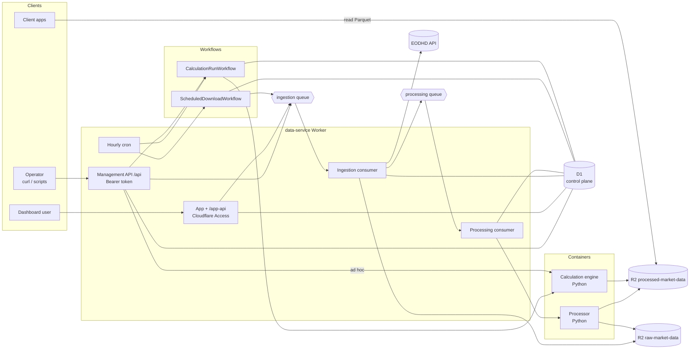

import { Card, CardGrid, LinkCard } from "@astrojs/starlight/components";

A personal market-data service on Cloudflare Workers. It downloads data for a
universe of symbols every day, builds **one Parquet file per symbol** in R2, and
runs **calculations** such as ex-ante volatility over portfolios, storing their
results next to the data.

Other apps manage the universe through a small API and **read the Parquet files
straight from R2**. The management API never serves market data; only the
dashboard does, so its users can browse the files.

```txt
processed-market-data/dataset=prices_eod/symbol=AAPL.US/data.parquet
processed-market-data/calculation=<calculation-id>/data.parquet
```

## The big picture



Two pipelines share the Worker, D1 and the processed bucket:

<CardGrid>
  <Card title="Market data" icon="download">
    The hourly cron starts one download run a day. Each enabled symbol's full
    history is fetched, stored raw, then rebuilt into its canonical Parquet file
    by the processor container.
  </Card>
  <Card title="Calculations" icon="puzzle">
    Saved calculations run on their own cron (or on demand) through a Workflow
    that calls the engine container, once per portfolio. Results accumulate in
    one Parquet file per calculation.
  </Card>
</CardGrid>

## Where to go next

<LinkCard title="Concepts" description="The vocabulary: datasets, tracked symbols, runs, jobs, portfolios, calculations." href="/docs/concepts/" />
<LinkCard title="Architecture" description="Every Cloudflare resource, what it owns, and how requests flow between them." href="/docs/architecture/" />
<LinkCard title="Management API" description="Every route, with curl examples." href="/docs/reference/api/" />
<LinkCard title="Writing a calculation type" description="Adding a calculation is one Python file." href="/docs/calculations/types/" />

## Repository layout

| Path | What |
| --- | --- |
| `src/` | The Worker (TypeScript, Hono, Effect) |
| `containers/processor/` | The Python processor container |
| `containers/engine/` | The Python calculation engine container |
| `app/` | The SvelteKit app (home page and dashboard), served at `/` |
| `docs/` | This site (Astro Starlight), served at `/docs/` |
| `migrations/` | D1 migrations |
