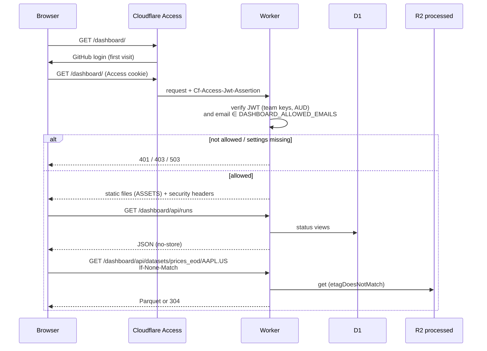

`$URL/dashboard/` is a Svelte app for operating the service:

- **Runs.** Ingestion runs with their Parquet rebuilds.
- **Symbols.** Tracked symbols with their latest activity. Add symbols (several
  at once), edit them, put them on or off the schedule, download them now, and
  change, pause or run the schedule.
- **Portfolios.** Create, rename and delete portfolios; add or delete
  snapshots (type or paste rows, or start from the latest snapshot).
- **Calculations.** Create and edit calculations with a JSON params editor and
  the type's params schema as help; pause, enable or run them for any as-of
  date; see their runs with each portfolio's outcome.
- **Explorer.** Browse any symbol's Parquet data or calculation's results:
  sort, filter by date, download.

## Request path



Access sits in front of `/dashboard` and `/docs` only, so the API keeps using
the management token. The Worker **also** verifies the token Access adds to each
request and the user's email, so the dashboard stays closed if the Access app
is removed or its policy is loosened. The management token is never sent to
the browser.

## The dashboard API

| Kind | Routes |
| --- | --- |
| Reads | `/me`, `/runs`, `/symbols`, `/options`, `/datasets/:dataset/:symbol`, `/calculations/:id/results` |
| Changes | `/registry`, `/ingestions`, `/schedule`, `/portfolios`, `/calculation-types`, `/calculate`, `/calculations` |

The change routes mount the same modules as the management API, with Access in
place of the token. Browsers send the Access cookie with cross-site requests
too, so every non-GET request must come from the dashboard's own origin
(`Origin` or `Sec-Fetch-Site`), or it gets `403`.

The explorer decodes Parquet in the browser with
[hyparquet](https://github.com/hyparam/hyparquet) (zstd through `fzstd`, both
plain JS because the CSP blocks WASM) and shows it in a TanStack Table. Columns
come from the file's schema, so a new dataset or calculation type needs no
dashboard change.

## One-time setup

Per environment (prod and dev have separate hostnames):

1. **GitHub login.** In Zero Trust, go to Settings > Authentication and add
   GitHub as a login method. This needs a GitHub OAuth app whose callback URL
   is `https://<team>.cloudflareaccess.com/cdn-cgi/access/callback`.
2. **Access application.** Under Access controls > Applications, add a
   self-hosted application:
   - Domains: `data-service.maximefilippini.me` with path
     `dashboard`, and the same hostname again with path `docs` (dev:
     `data-service-dev.maximefilippini.me`). Both paths must be in
     this one application, since the Worker checks a single AUD.
   - Login methods: GitHub only, with instant auth.
   - Policy: Allow, include Emails = your GitHub account's primary email.
3. **Secrets.** Copy the application's AUD tag from its settings, then:

   ```sh
   pnpm exec wrangler secret put ACCESS_TEAM_DOMAIN         # https://<team>.cloudflareaccess.com
   pnpm exec wrangler secret put ACCESS_AUD                 # the application's AUD tag
   pnpm exec wrangler secret put DASHBOARD_ALLOWED_EMAILS   # your email; comma-separated for more
   ```

   Add `--env dev` for the dev environment, with the dev application's AUD.

If any of these settings is missing, the dashboard returns `503`.
