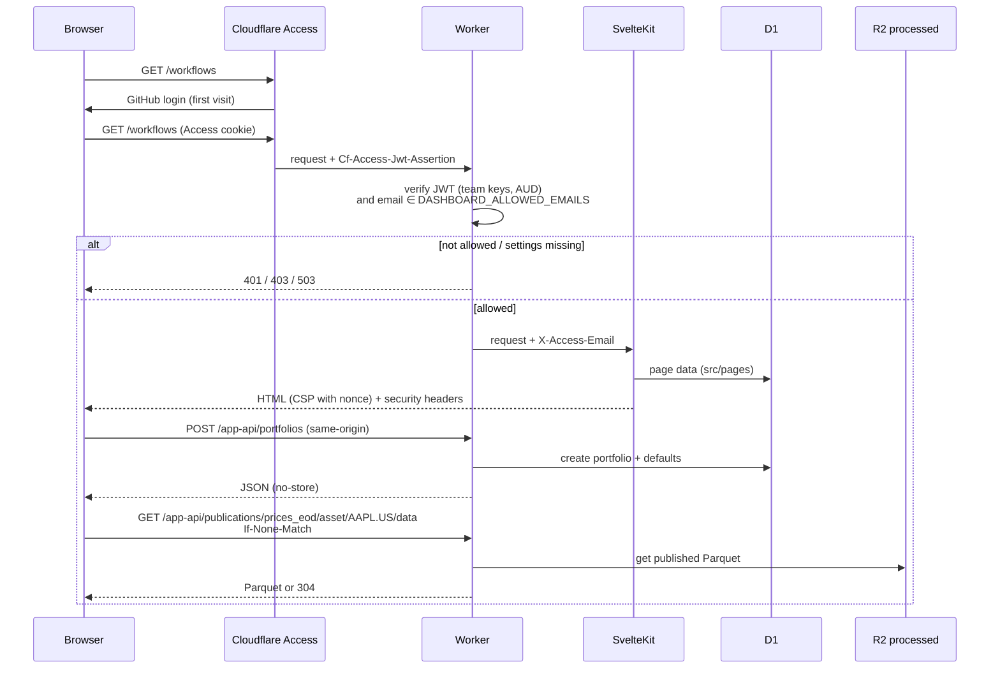

`$URL/` is a SvelteKit app for inspecting workflows, runs, and published data
and managing dated portfolio holdings:

- **Home** (`/`): summary counts for assets, portfolios, workflow definitions,
  and published datasets, plus workflow definitions, recent runs, and recent
  publications.
- **Assets** (`/assets`, `/assets/:symbol`): registered assets with provider
  settings, assigned workflows and daily schedules, published datasets, and
  recent runs (read-only; manage via `/api/assets`).
- **Portfolios** (`/portfolios`, `/portfolios/:id`): create, rename, and delete
  portfolios; add or delete dated holdings snapshots (type or paste rows, with
  registered asset symbol suggestions); inspect assigned workflows, published
  datasets, and recent runs.
- **Workflows** (`/workflows`, `/workflows/:id`): read-only inspection of
  workflow definitions, defaults for new subjects, assignments, schedules, and
  ordered steps with parameters and visible input/output connections.
- **Runs** (`/workflow-runs`, `/workflow-runs/:id`): filter runs by asset
  symbol, status, and trigger; inspect every step's status, waiting deadline
  and missing inputs, retry count, errors, inline outputs, temporary artifact
  downloads, and published dataset links.
- **Explore data** (`/explore`): browse any published asset (`prices_eod`) or
  portfolio (`portfolio_volatility`) Parquet dataset: sort, filter by date, and
  download.
- **Docs** (`/docs/`): this documentation site.

The old `/dashboard/` URLs redirect to `/`. A drag-and-drop workflow builder
is deliberately out of scope.

## How it is built

The app lives in `app/`. `@sveltejs/adapter-cloudflare` builds it into a
request handler imported by `src/index.ts` and static files in `dist/` next to
the docs. The Worker routes every request:

| Path          | Goes to                                         | Auth              |
| ------------- | ----------------------------------------------- | ----------------- |
| `/api/*`      | [Management API](/docs/reference/api/)          | Bearer token      |
| `/app-api/*`  | The app's JSON API, called from the browser     | Cloudflare Access |
| `/docs/*`     | These docs (static files)                       | Cloudflare Access |
| anything else | The SvelteKit app: pages and their static files | Cloudflare Access |

Pages load data on the server in `+page.server.ts` through the shared read-only
facade (`src/pages/`), using the same D1/Effect adapters as `/api/*`. Browser
mutations and Parquet downloads go through `/app-api/*`.

## Request path



The Worker independently verifies `Cf-Access-Jwt-Assertion` and checks the
email against `DASHBOARD_ALLOWED_EMAILS`, so the app stays closed even if an
Access policy is loosened. The management token is never sent to the browser.

## The app's JSON API

Mounted at `/app-api/*` behind Access and same-origin mutation checks (`Origin`
or `Sec-Fetch-Site: same-origin` required on non-GET requests, else `403`):

- `GET /app-api/me`
- `/app-api/assets`
- `/app-api/portfolios`
- `/app-api/workflows`
- `/app-api/step-types`
- `/app-api/workflow-defaults`
- `/app-api/workflow-assignments`
- `/app-api/workflow-runs`
- `/app-api/publications` (metadata + Parquet streaming at `/:dataset/:kind/:subject/data`)

The explorer decodes Parquet in the browser with
[hyparquet](https://github.com/hyparam/hyparquet) (and `fzstd`, both plain JS
because the CSP blocks WASM) and displays rows in TanStack Table. Columns come
from the file's schema, so new published datasets work automatically.

## One-time Access setup

Per environment (prod and dev have separate hostnames):

1. **GitHub login.** In Zero Trust → Settings → Authentication, add GitHub
   (callback URL `https://<team>.cloudflareaccess.com/cdn-cgi/access/callback`).
2. **Access application.** Under Access controls → Applications, add a
   self-hosted application for `data-service.maximefilippini.me` (or
   `data-service-dev.maximefilippini.me`) with no path, GitHub login, and an
   Allow policy for your email.
3. **Bypass for `/api`.** Add a second self-hosted application for the same
   hostname with path `api`, action **Bypass**, include Everyone.
4. **Secrets.** Copy the first application's AUD tag, then run:

   ```sh
   pnpm exec wrangler secret put ACCESS_TEAM_DOMAIN         # https://<team>.cloudflareaccess.com
   pnpm exec wrangler secret put ACCESS_AUD                 # the application's AUD tag
   pnpm exec wrangler secret put DASHBOARD_ALLOWED_EMAILS   # comma-separated emails
   ```

   Add `--env dev` for dev. Missing settings return `503`.
