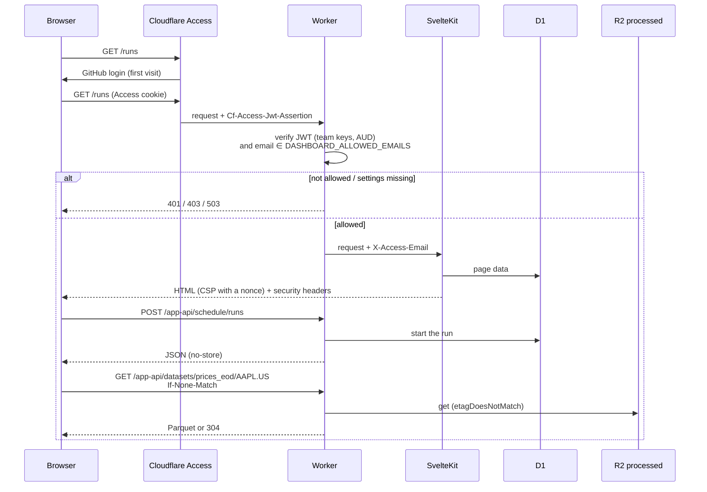

`$URL/` is a SvelteKit app for operating the service:

- **Home** (`/`). How both pipelines are doing: symbol counts and failed
  downloads or rebuilds, the daily schedule and its latest run (with a "Run
  schedule now" button), the latest failed downloads, each calculation's latest
  run and the next scheduled ones. Links to every section and to these docs.
- **Ingestion runs** (`/runs`). Ingestion runs with their Parquet rebuilds,
  filtered by `?symbol=` and `?status=`.
- **Symbols** (`/symbols`). Tracked symbols with their latest activity. Add
  symbols (several at once), edit them, put them on or off the schedule,
  download them now, and change, pause or run the schedule.
- **Portfolios** (`/portfolios`, `/portfolios/:id`). Create, rename and delete
  portfolios; add or delete snapshots (type or paste rows, or start from the
  latest snapshot).
- **Calculations** (`/calculations`, `/calculations/:id`). Create and edit
  calculations with a JSON params editor and the type's params schema as help;
  pause, enable or run them for any as-of date; see their runs with each
  portfolio's outcome.
- **Explorer** (`/explore`). Browse any symbol's Parquet data or calculation's
  results: sort, filter by date, download.

The old `/dashboard/` URLs redirect to the home page.

## How it is built

The app lives in `app/`. adapter-cloudflare builds it into a request handler,
which the Worker's entry point (`src/index.ts`) imports, and into static files
in `dist/`, next to the docs. The Worker routes every request:

| Path | Goes to | Auth |
| --- | --- | --- |
| `/api/*` | [Management API](/docs/reference/api/) | Bearer token |
| `/app-api/*` | The app's JSON API, called from the browser | Cloudflare Access |
| `/docs/*` | These docs (static files) | Cloudflare Access |
| anything else | The SvelteKit app: pages and their static files | Cloudflare Access |

Each page loads its data on the server, in its `+page.server.ts`, by reading
D1 through the Worker's own modules (`src/pages`). Changes, "load more" and
refreshes after a change go through `/app-api` from the browser. The calculation
types come from the engine container, which may be starting up, so pages load
them in the browser after the page itself.

## Request path



Access covers the whole hostname except `/api`, which scripts and other apps
reach with the management token. The Worker **also** verifies the token Access
adds to each request and the user's email, so the app stays closed if the
Access app is removed or its policy is loosened. It then hands SvelteKit the
user's email in `X-Access-Email`, a header it always sets itself. The
management token is never sent to the browser.

## The app's JSON API

| Kind | Routes |
| --- | --- |
| Reads | `/me`, `/runs`, `/symbols`, `/options`, `/datasets/:dataset/:symbol`, `/calculations/:id/results` |
| Changes | `/registry`, `/ingestions`, `/schedule`, `/portfolios`, `/calculation-types`, `/calculate`, `/calculations` |

All under `/app-api`. The change routes mount the same modules as the
management API, with Access in place of the token. Browsers send the Access
cookie with cross-site requests too, so every non-GET request must come from
the app's own origin (`Origin` or `Sec-Fetch-Site`), or it gets `403`.

The explorer decodes Parquet in the browser with
[hyparquet](https://github.com/hyparam/hyparquet) (zstd through `fzstd`, both
plain JS because the CSP blocks WASM) and shows it in a TanStack Table. Columns
come from the file's schema, so a new dataset or calculation type needs no
change to the app.

## One-time setup

Per environment (prod and dev have separate hostnames):

1. **GitHub login.** In Zero Trust, go to Settings > Authentication and add
   GitHub as a login method. This needs a GitHub OAuth app whose callback URL
   is `https://<team>.cloudflareaccess.com/cdn-cgi/access/callback`.
2. **Access application.** Under Access controls > Applications, add a
   self-hosted application:
   - Domain: `data-service.maximefilippini.me` with no path, so it covers the
     whole hostname (dev: `data-service-dev.maximefilippini.me`).
   - Login methods: GitHub only, with instant auth.
   - Policy: Allow, include Emails = your GitHub account's primary email.
3. **Bypass for the API.** Add a second self-hosted application for the same
   hostname with path `api`, and one policy: action Bypass, include Everyone.
   Access applies the most specific path, so `/api/*` skips the login and the
   management token protects it.
4. **Secrets.** Copy the first application's AUD tag from its settings, then:

   ```sh
   pnpm exec wrangler secret put ACCESS_TEAM_DOMAIN         # https://<team>.cloudflareaccess.com
   pnpm exec wrangler secret put ACCESS_AUD                 # the application's AUD tag
   pnpm exec wrangler secret put DASHBOARD_ALLOWED_EMAILS   # your email; comma-separated for more
   ```

   Add `--env dev` for the dev environment, with the dev application's AUD.

If any of these settings is missing, the app and the docs return `503`.
