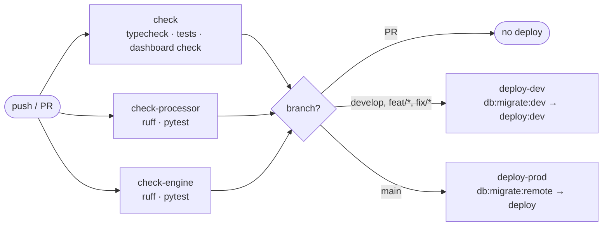
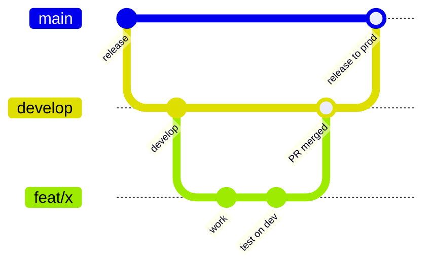

GitHub Actions (`.github/workflows/deploy.yml`) checks everything on every
push and pull request, then applies D1 migrations and deploys.



| Branch | Target |
| --- | --- |
| `main` | production (`data-service`) |
| `develop`, `feat/*`, `fix/*` | dev environment (`data-service-dev`) |

Each deploy builds the dashboard and these docs into the Worker's static
assets, and builds the processor and engine images and ships them with the
Worker, so everything always comes from the same commit. Wrangler only rolls
out containers when the image changes.

## Release flow



Push a `feat/*` or `fix/*` branch and test it on dev, merge it into `develop`,
then merge `develop` into `main` to release.

:::caution
All branches share the dev environment, so the latest push wins. A migration
applied to dev from a branch stays applied even if the branch is abandoned.
:::

To deploy any other branch to dev, run the workflow manually from the Actions
tab. The workflow needs a `CLOUDFLARE_API_TOKEN` repository secret. To deploy
by hand instead, with Docker running:

```sh
pnpm db:migrate:remote && pnpm run deploy   # production
pnpm db:migrate:dev && pnpm deploy:dev      # dev
```

## Dev environment

A separate deployment for end-to-end testing of any branch at
`https://data-service-dev.maxime-filippini.workers.dev`. It has its own
database (`data-service-market-data-dev`), buckets (`raw-market-data-dev`,
`processed-market-data-dev`), queues (`*-dev`), Workflows and secrets, and
**no cron**: use "Run now" or `POST /schedule/runs` to try the schedule there.

## Resources and secrets

Remote resources: the D1 database, the raw and processed buckets, and the
`market-data-ingestion`, `market-data-processing` queues and their DLQs.

```sh
pnpm exec wrangler secret put EODHD_API_TOKEN
pnpm exec wrangler secret put MANAGEMENT_API_TOKEN
pnpm exec wrangler secret put R2_ENDPOINT_URL        # https://<account-id>.r2.cloudflarestorage.com
pnpm exec wrangler secret put R2_ACCESS_KEY_ID       # used by the processor and engine containers
pnpm exec wrangler secret put R2_SECRET_ACCESS_KEY
```

Plus the three [dashboard secrets](/docs/operations/dashboard/#one-time-setup).
For dev, add `--env dev` and use an R2 API token scoped to the two dev buckets:

```sh
for name in EODHD_API_TOKEN MANAGEMENT_API_TOKEN R2_ENDPOINT_URL R2_ACCESS_KEY_ID R2_SECRET_ACCESS_KEY \
  ACCESS_TEAM_DOMAIN ACCESS_AUD DASHBOARD_ALLOWED_EMAILS; do
  pnpm exec wrangler secret put "$name" --env dev
done
```
