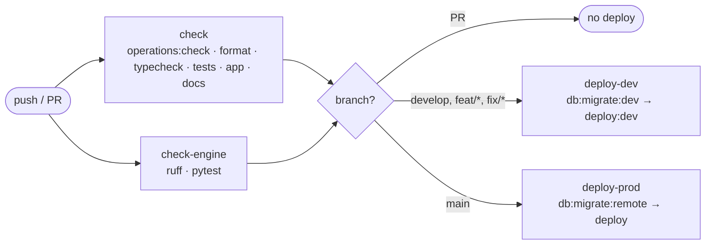
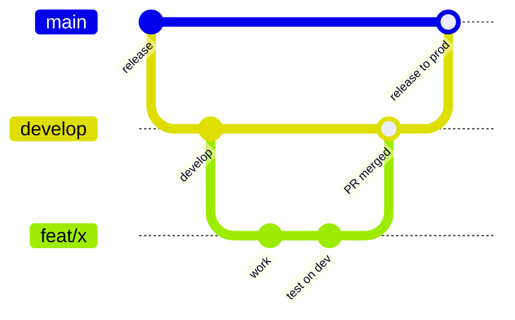

GitHub Actions (`.github/workflows/deploy.yml`) checks the Worker, generated
contracts, SvelteKit app, docs, and Python container on every push and pull
request, then applies D1 migrations and deploys.



| Branch                       | Target                               |
| ---------------------------- | ------------------------------------ |
| `main`                       | production (`data-service`)          |
| `develop`, `feat/*`, `fix/*` | dev environment (`data-service-dev`) |

Each deploy builds the SvelteKit app and docs into the Worker's static assets,
and builds the single Python container image (`containers/engine/`) alongside
the Worker so both always come from the same commit. Wrangler only rolls out
the container when its image changes.

## Release flow



Push a `feat/*` or `fix/*` branch to test on dev, merge into `develop`, then
merge `develop` into `main` to release.

:::caution
All non-main branches share the dev environment, so the latest push wins. A D1
migration applied to dev stays applied even if the branch is abandoned.
:::

To deploy by hand (with Docker running):

```sh
pnpm db:migrate:remote && pnpm run deploy   # production
pnpm db:migrate:dev && pnpm deploy:dev      # dev
```

## Dev environment

A separate deployment for end-to-end testing at
`https://data-service-dev.maximefilippini.me`, with its own D1 database
(`data-service-market-data-dev`), R2 buckets (`raw-market-data-dev`,
`processed-market-data-dev`), Workflow (`data-service-workflow-runs-dev`),
container, and secrets. Dev has **no cron trigger** (`triggers: { crons: [] }`);
start runs manually with `POST /api/runs`.

## Scheduled workflow dispatch

`WORKFLOW_DISPATCH` in `wrangler.jsonc` is `"on"`, so the production hourly
cron (`0 * * * *`) runs `scheduledWorkflowTick` to reconcile active runs and
dispatch enabled workflow assignments at their daily UTC hour. Set
`WORKFLOW_DISPATCH` to `"off"` and deploy if you ever need to pause all
scheduled dispatch without editing individual definitions.

## Resources and secrets

Remote resources per environment: one D1 database, two R2 buckets (raw with
the 30-day `runs/` lifecycle rule, and processed), one Cloudflare Workflow
(`DefinitionRunWorkflow`), and one Container Durable Object
(`CalculationEngine`).

```sh
pnpm exec wrangler secret put EODHD_API_TOKEN
pnpm exec wrangler secret put MANAGEMENT_API_TOKEN
pnpm exec wrangler secret put R2_ENDPOINT_URL        # https://<account-id>.r2.cloudflarestorage.com
pnpm exec wrangler secret put R2_ACCESS_KEY_ID       # used by the Python engine container
pnpm exec wrangler secret put R2_SECRET_ACCESS_KEY
```

Plus the three [Access secrets](/docs/operations/dashboard/#one-time-access-setup).
For dev, pass `--env dev` and scope the R2 token to the two dev buckets:

```sh
for name in EODHD_API_TOKEN MANAGEMENT_API_TOKEN R2_ENDPOINT_URL R2_ACCESS_KEY_ID R2_SECRET_ACCESS_KEY \
  ACCESS_TEAM_DOMAIN ACCESS_AUD DASHBOARD_ALLOWED_EMAILS; do
  pnpm exec wrangler secret put "$name" --env dev
done
```
