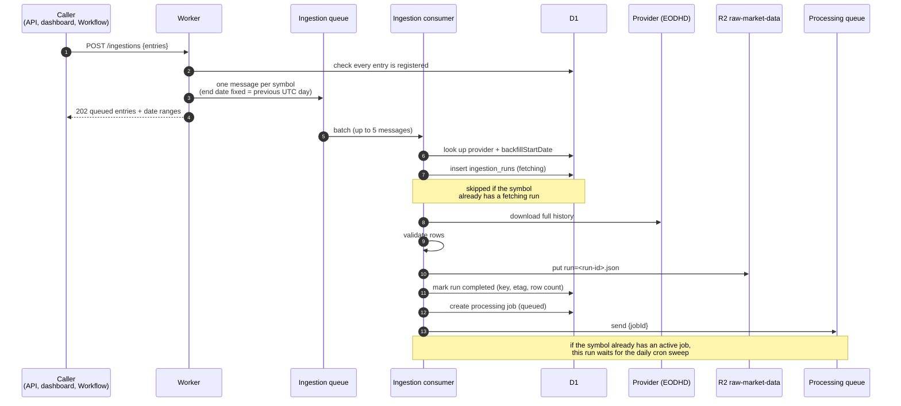
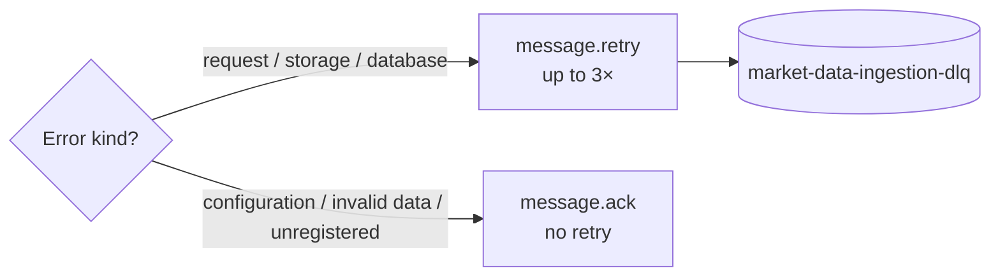
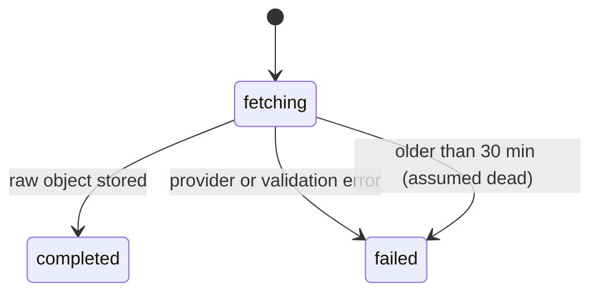

An **ingestion run** downloads a symbol's full history from its provider and
stores the validated response once, as an immutable object in the
`raw-market-data` bucket. Runs come from the [daily schedule](/docs/pipeline/schedule/)
or from `POST /ingestions`.

## Flow



The message fixes the snapshot's **end date** (the previous UTC day), so a
retry downloads exactly the same range.

## Rules

- **One download at a time per symbol.** Starting a run is skipped if the
  symbol already has a `fetching` run; the partial unique index
  `ingestion_runs_one_fetching` backs this up. A `fetching` run older than 30
  minutes is assumed dead and failed first.
- **Fresh run per delivery.** Each queue delivery gets a new run ID.
- **Retries.** Provider request, storage and database errors retry the message (3
  times, 60 seconds apart, then the DLQ). Bad configuration, invalid provider
  data and unregistered symbols are acknowledged without retry.



## Run states



## Raw envelope

Each completed run writes one JSON object at
`raw-market-data/dataset=<dataset>/symbol=<symbol>/run=<run-id>.json`:

```json
{
  "version": 1,
  "runId": "…",
  "dataset": "prices_eod",
  "provider": "eodhd",
  "symbol": "AAPL.US",
  "requestedRange": { "from": "2016-01-01", "to": "2026-10-05" },
  "receivedAt": "…",
  "entries": []
}
```

## Datasets and providers

Identity is `(dataset, symbol)`. The provider is a setting on each tracked
symbol that picks the download adapter, so switching vendor doesn't move the
Parquet file. The allowed combinations live in `datasetProviders` in
`src/market-data/schemas.ts`.

To add a dataset (for example FRED rates):

1. Add it to `DatasetSchema` / `ProviderSchema` and `datasetProviders`.
2. Write a `MarketDataSource` adapter that validates the provider's rows.
3. Add the entry model and Parquet schema in the processor.
