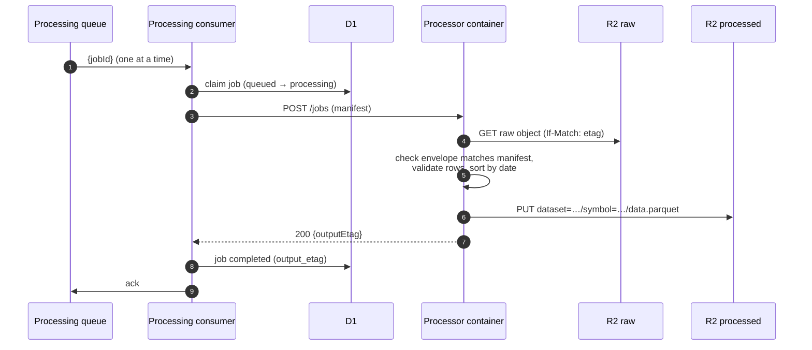
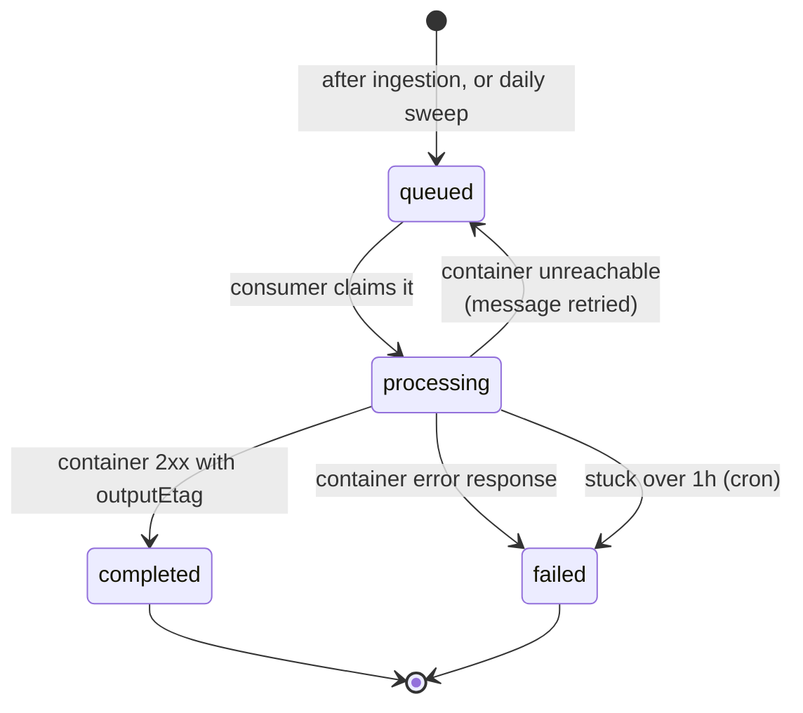

A **processing job** rebuilds one symbol's canonical Parquet file from one
completed ingestion run. Every ingestion run is a full-history snapshot, so
each job rebuilds the file from the latest completed run only. Rebuilds don't
depend on earlier state: retrying or repeating a job is always safe.

## Flow

The consumer processes one message at a time (`max_concurrency: 1`,
`max_batch_size: 1`), against a single container instance.

## Job lifecycle

- **Creating jobs.** The ingestion consumer queues a job right after each run.
  As a fallback, the cron queues a job for each symbol whose latest completed
  run has no job yet, unless the symbol already has an active job.
- **One writer per file.** The unique index `processing_jobs_one_active`
  allows one `queued` or `processing` job per `(dataset, symbol)`.
- **Failures.** A failed job is not retried for the same run. The next
  download creates a new run and a new job.
- **Delivery.** At 02:00 UTC the cron resends every queued job, so a lost
  queue message only delays processing.

## What the processor checks

The processor reads exactly the raw object version in the manifest (`IfMatch`
on its ETag). It checks that the envelope matches the manifest (run, dataset,
symbol, provider, range, row count) and that every row is valid. Then it writes
a date-sorted Parquet file. If a date appears twice, the later row wins.

`prices_eod` columns:

| Column | Type |
| --- | --- |
| `date` | Date |
| `open`, `close`, `high`, `low`, `adjusted_close` | Float64 |
| `volume` | Int64 |

See [Containers](/docs/reference/containers/#processor) for the manifest format.
