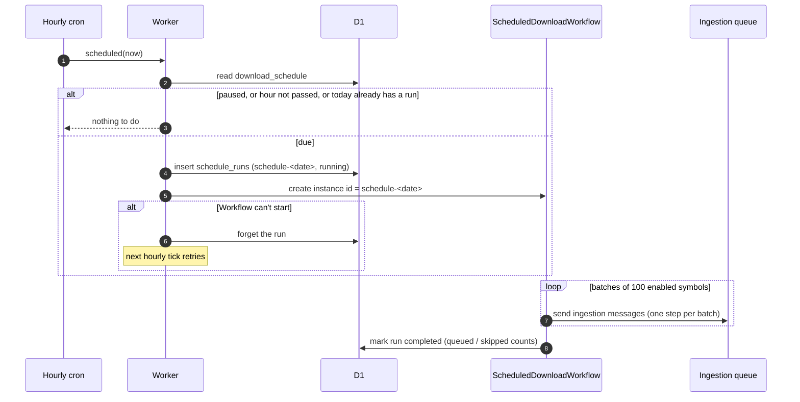
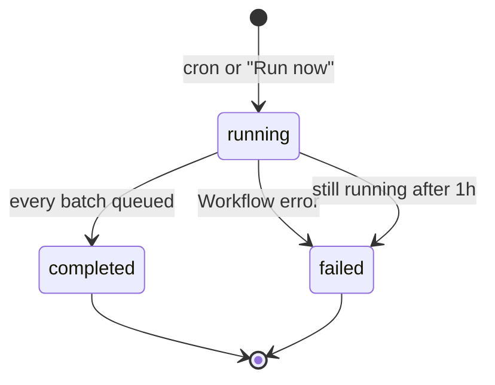

One schedule downloads every enabled symbol once a day. The
`download_schedule` table holds its **UTC hour** and a **paused** flag. It
starts paused, so deploying never starts downloads by surprise. Both the API
(`/schedule`) and the dashboard can change them.

## How a day's run starts



- **Trigger.** The cron fires at the top of every hour. Once the schedule's
  hour has passed and today has no scheduled run, it records the run as
  `schedule-<date>` and starts a Workflow instance with the same ID. A missed
  hour is caught up on the next tick.
- **At most once a day.** A partial unique index (`schedule_runs_one_per_day`)
  allows one scheduled run per UTC day, and a duplicate Workflow ID is refused
  too.
- **Workflow.** Lists the enabled symbols whose history has started, sends them
  to the ingestion queue in batches of 100, then records how many it queued.
  Downloads run up to the **day before** the run, as with manual ingestions.
- **Manual runs.** "Run now" (`POST /schedule/runs`) starts the same Workflow as
  a `manual-<date>-<id>` run. It doesn't use up the day's scheduled run.
- **Failures.** If the Workflow can't start, the cron forgets the run and the
  next tick retries. A run still `running` after an hour is marked failed.

## Run states



## Controlling it

```sh
# Show it, with the next run time
curl "$URL/api/schedule" -H "Authorization: Bearer $MANAGEMENT_API_TOKEN"

# Run after 06:00 UTC and resume it (both fields are optional)
curl -X PATCH "$URL/api/schedule" \
  -H "Authorization: Bearer $MANAGEMENT_API_TOKEN" \
  -H 'Content-Type: application/json' \
  -d '{"hourUtc":6,"paused":false}'

# Run it now, on top of the daily run
curl -X POST "$URL/api/schedule/runs" -H "Authorization: Bearer $MANAGEMENT_API_TOKEN"
```

:::note
The dev environment has no cron. Use "Run now" or `POST /schedule/runs` there.
:::
