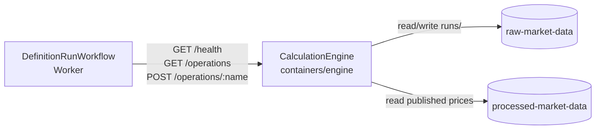

One Python container (`containers/engine/`, FastAPI + Polars + Pydantic) runs
all Python-backed workflow operations and ships alongside the Worker from the
same commit. It is a Durable Object–backed Cloudflare Container
(`CalculationEngine`, single instance `getByName("engine")`).

The container is reachable **only through the Worker**, so it has no auth
layer. It never touches D1: every input arrives in the JSON request and every
result or error returns in the HTTP response.



## HTTP endpoints

| Endpoint                  | Purpose                                                                                                                                |
| ------------------------- | -------------------------------------------------------------------------------------------------------------------------------------- |
| `GET /health`             | Liveness probe (`{"status": "ok"}`).                                                                                                   |
| `GET /operations`         | Lists every registered operation with its description and request/response JSON Schemas.                                               |
| `POST /operations/{name}` | Validates `{execution: {runId, stepId}, inputs, params}`, runs the operation, validates its response, and returns small JSON or error. |

### Success response (`200`)

Small JSON matching the operation's Pydantic response model (for example an
artifact reference under `runs/<runId>/<stepId>/` plus any small summary
fields):

```json
{
  "data": {
    "id": "runs/<run-id>/volatility/volatility.parquet",
    "format": "parquet",
    "schema": "portfolio-volatility/v1"
  },
  "summary": {
    "volatility": 0.16655,
    "observations": 252,
    "windowStart": "2025-11-18",
    "windowEnd": "2026-11-18",
    "holdingsDate": "2026-10-15"
  }
}
```

### Error response (non-2xx)

Failures are never disguised as HTTP `200`:

```json
{
  "error": {
    "kind": "terminal",
    "message": "Only 10 daily returns up to 2026-11-18, need 252",
    "issues": []
  }
}
```

- `404` (`terminal`): unknown operation.
- `422` (`terminal`): schema validation error (populates `issues`) or
  deterministic domain error.
- `503` / `500` (`transient`): storage or unexpected failure; retried within
  the step's bounded retry policy.

## Generated TypeScript contracts

Pydantic models in `containers/engine/src/data_service_engine/operations/` are
exported with `uv run engine export-schemas` into `src/operations/schemas.json`
and compiled into `src/operations/contracts.generated.ts`:

```sh
pnpm operations:generate
pnpm operations:check
```

## Configuration

| Variable               | In Cloudflare container                                    | Locally (`pnpm workflow:fixture` / tests)  |
| ---------------------- | ---------------------------------------------------------- | ------------------------------------------ |
| `ARTIFACT_ROOT`        | _(unset)_                                                  | Local directory holding `runs/…`           |
| `PROCESSED_ROOT`       | _(unset)_                                                  | Local directory holding published datasets |
| `ARTIFACT_BUCKET`      | `RAW_BUCKET_NAME` (`raw-market-data` / `-dev`)             | _(unset)_                                  |
| `PROCESSED_BUCKET`     | `PROCESSED_BUCKET_NAME` (`processed-market-data` / `-dev`) | _(unset)_                                  |
| `R2_ENDPOINT_URL`      | `https://<account-id>.r2.cloudflarestorage.com`            | _(unset)_                                  |
| `R2_ACCESS_KEY_ID`     | R2 S3 access key                                           | _(unset)_                                  |
| `R2_SECRET_ACCESS_KEY` | R2 S3 secret key                                           | _(unset)_                                  |

Bucket names have no defaults, so a misconfigured container fails instead of
touching production buckets.
