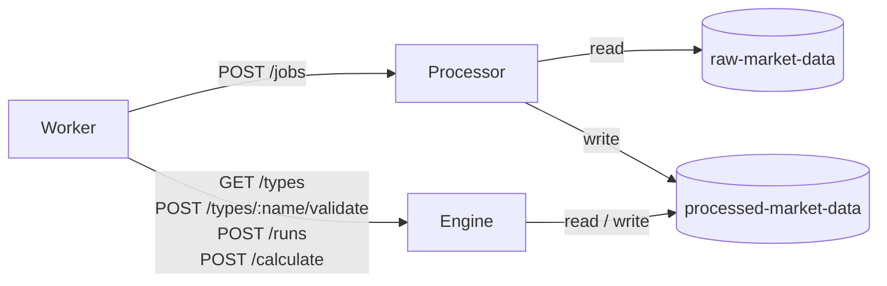

Both containers are Python (FastAPI, polars) images that the Worker builds and
deploys alongside itself, so all three always come from the same commit. Each
is a Durable Object-backed Cloudflare Container with a single instance
(`getByName("processor")`, `getByName("engine")`).

They are reachable **only through the Worker**, so they have no
authentication. Neither one touches D1: they get everything in the request and
report back in the response.



## Processor

Turns one raw provider download into the canonical Parquet object for a
symbol. Code: `containers/processor/`.

| Endpoint | Does |
| --- | --- |
| `GET /health` | Liveness probe |
| `POST /jobs` | Rebuild one Parquet file from one raw object |

The processing consumer sends a manifest:

```json
{
  "jobId": "…",
  "dataset": "prices_eod",
  "symbol": "AAPL.US",
  "outputKey": "dataset=prices_eod/symbol=AAPL.US/data.parquet",
  "input": {
    "runId": "…",
    "provider": "eodhd",
    "requestedRange": { "from": "2016-01-01", "to": "2026-10-05" },
    "key": "dataset=prices_eod/symbol=AAPL.US/run=….json",
    "etag": "…",
    "rowCount": 2700
  }
}
```

| Response | Worker does |
| --- | --- |
| `200 {"outputEtag": "…"}` | Completes the job |
| `500 {"detail": "…"}` | Fails the job with the detail |
| `422` | Fails the job: the manifest itself was invalid |
| Network error | Returns the job to `queued` and retries the message |

Every job is a full rebuild from one full-history snapshot, so running the
same manifest twice is safe. To add a dataset, add its entry model and
envelope literal in `models.py` and its Parquet schema in `processor.py`.

## Engine

Holds every calculation type, validates params, runs calculations over the
canonical files and writes their results. Code: `containers/engine/`.

| Endpoint | Does |
| --- | --- |
| `GET /health` | Liveness probe |
| `GET /types` | Each type's name, description, `takesPortfolio`, params JSON Schema and output columns |
| `POST /types/:name/validate` | `{"params": {…}}` → `200 {"params": …}` with defaults filled in, `422` with errors, or `404` |
| `POST /runs` | Run a saved calculation for one as-of date and write its rows to R2 |
| `POST /calculate` | Run an ad hoc calculation and return its rows. Writes nothing |

### `POST /runs`

```json
{
  "runId": "…",
  "type": "ex_ante_vol",
  "params": { "window": 252 },
  "asOf": "2026-10-16",
  "portfolios": [
    {
      "id": "…",
      "name": "Core",
      "snapshots": [
        { "holdingsDate": "2026-09-30", "holdings": [{ "symbol": "AAPL.US", "weight": 0.6 }] }
      ]
    }
  ],
  "outputKey": "calculation=<id>/data.parquet"
}
```

A well-formed request always gets `200`, with what happened:

```json
{
  "status": "partial",
  "error": null,
  "portfolios": [
    { "portfolioId": "…", "status": "completed", "rowCount": 1, "error": null },
    { "portfolioId": "…", "status": "failed", "rowCount": 0, "error": "No prices_eod data for X.US" }
  ],
  "rowCount": 1,
  "outputEtag": "…"
}
```

- `completed`: every portfolio worked. `partial`: some failed and the others
  were written. `failed`: nothing was written; `error` says why (unknown type,
  invalid params, every portfolio failed, R2 errors).
- The run replaces every row for its as-of date in `outputKey` and keeps the
  other dates. A portfolio that failed loses its earlier rows for that date.
- The write is conditional on the object not changing since it was read.

### `POST /calculate`

```json
{
  "type": "ex_ante_vol",
  "params": {},
  "asOf": "2026-10-16",
  "portfolio": { "holdings": [{ "symbol": "AAPL.US", "weight": 1 }] }
}
```

Returns `{"rows": [...]}` (NaN and infinity become `null`), or an Arrow IPC
stream with `Accept: application/vnd.apache.arrow.stream`. `portfolio` takes
`snapshots` like a run, or plain `holdings`, which become one undated snapshot
that counts as held at all times.

## Configuration

| Variable | Processor | Engine |
| --- | :---: | :---: |
| `R2_ENDPOINT_URL` | ✓ | ✓ |
| `R2_ACCESS_KEY_ID` | ✓ | ✓ |
| `R2_SECRET_ACCESS_KEY` | ✓ | ✓ |
| `RAW_BUCKET` | ✓ | |
| `PROCESSED_BUCKET` | ✓ | ✓ |

The Worker sets the bucket names per environment. They have no defaults, so a
misconfigured deployment fails instead of touching production data.
