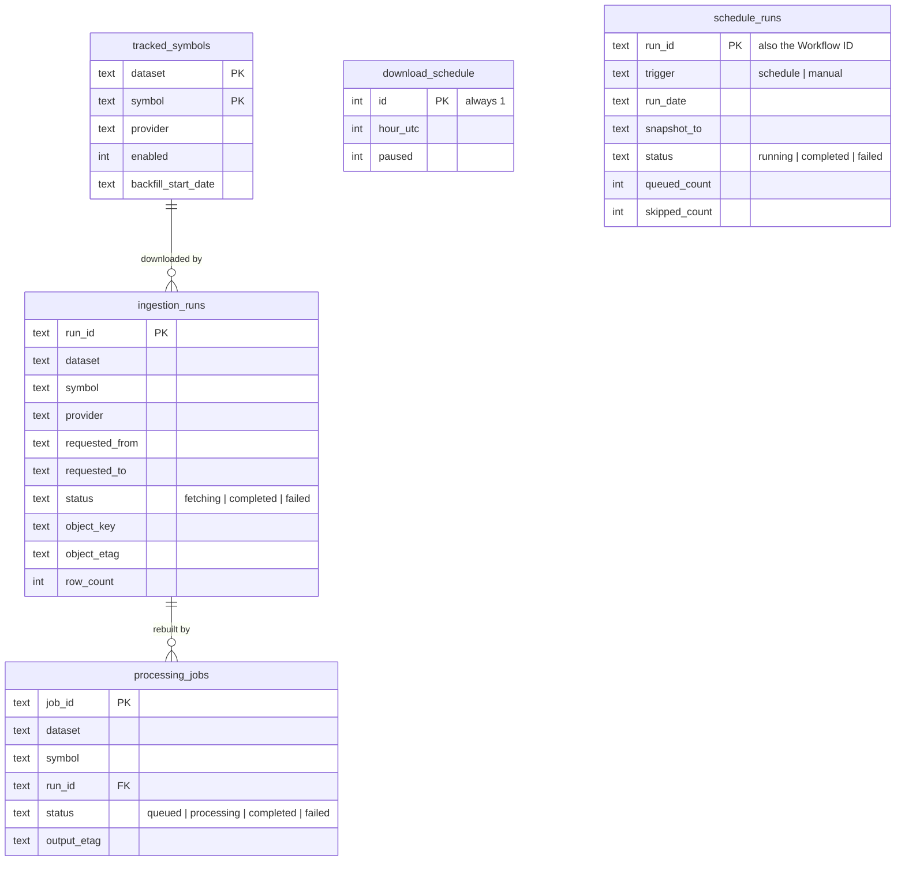
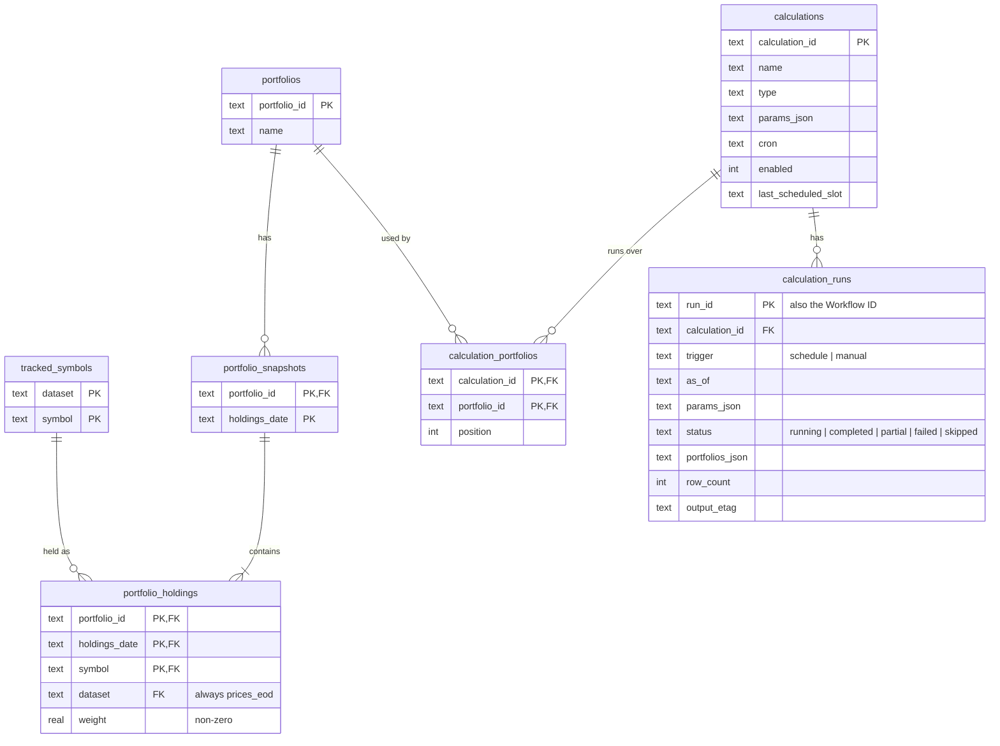

D1 (`data-service-market-data`) holds every piece of state: the universe, the
schedule, runs, jobs, portfolios and calculations. It holds **no market data
and no results**; those live in R2. Migrations are in `migrations/`.

## Market data

## Portfolios and calculations

Deleting a portfolio cascades to its snapshots and holdings; deleting a
calculation cascades to its portfolio links and runs. The foreign keys from
`portfolio_holdings` to `tracked_symbols` and from `calculation_portfolios` to
`portfolios` don't cascade, so a held symbol or a used portfolio can't be
deleted.

## Concurrency rules

Partial unique indexes enforce the service's "one at a time" rules in the
database, so two Workers racing can't both win:

| Index | Rule |
| --- | --- |
| `ingestion_runs_one_fetching` | One `fetching` run per `(dataset, symbol)` |
| `processing_jobs_one_active` | One `queued` or `processing` job per `(dataset, symbol)` |
| `schedule_runs_one_per_day` | One `schedule`-triggered run per `run_date` |
| `calculation_runs_one_running` | One `running` run per calculation |
