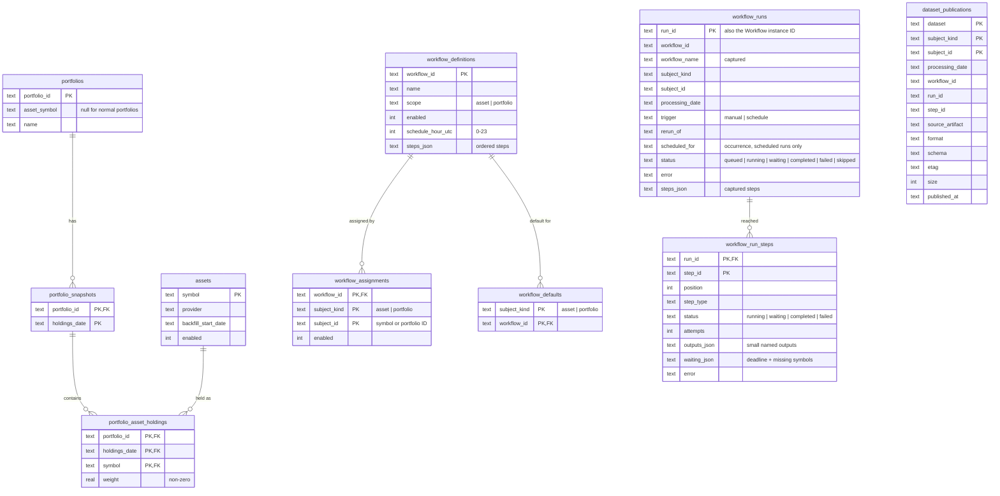

D1 (`data-service-market-data`) holds all configuration, operational run
history, and publication metadata. It holds **no market data or Parquet
files**; those live in R2. Migrations live in `migrations/` (`0001`–`0014`).

## Active workflow tables

Key persistence rules:

- **Definitions as data.** `workflow_definitions` stores ordered steps, params,
  and input bindings in `steps_json`, while searchable fields (`scope`,
  `enabled`, `schedule_hour_utc`) are ordinary columns. Scope changes are
  guarded conditionally against existing assignments and defaults.
- **Default assignment on create.** Creating an asset or portfolio inserts its
  `workflow_defaults` assignments in the same D1 batch.
- **History independent of configuration.** `workflow_runs` and
  `dataset_publications` intentionally have **no foreign keys** to `assets`,
  `portfolios`, `workflow_definitions`, or `workflow_assignments`. Deleting
  configuration is blocked while an active run exists, and allowed deletion
  retains complete run history and current publication metadata.
- **Holdings references.** `portfolio_asset_holdings` references `assets(symbol)`
  without cascade delete, and `D1AssetStoreLive.remove` checks both
  `portfolio_asset_holdings` and historical `portfolio_holdings` before
  allowing asset deletion.

The subject kinds are listed once, in `SUBJECT_KINDS`
(`src/workflows/subjects.ts`). `CHECK` constraints repeat them on
`workflow_definitions.scope` and on `subject_kind` in `workflow_assignments`,
`workflow_defaults`, `workflow_runs` and `dataset_publications`. Adding or
removing a kind therefore needs a migration that rebuilds those tables,
because SQLite can't alter a `CHECK` constraint.

## Concurrency rules

Partial unique indexes enforce the service's "one at a time" rules atomically
in D1 so concurrent Workers cannot race:

| Index                              | Rule                                                                   |
| ---------------------------------- | ---------------------------------------------------------------------- |
| `workflow_runs_one_active`         | One `queued`, `running`, or `waiting` run per assignment               |
| `workflow_runs_one_per_occurrence` | One run (`queued` or `skipped`) per assignment and schedule occurrence |

## Retained pre-workflow tables

Migrations `0001`–`0008` are preserved untouched so existing D1 databases never
lose stored history:

- `portfolio_holdings`: read alongside `portfolio_asset_holdings` via
  `UNION ALL` in `D1PortfoliosLive` and checked by `D1AssetStoreLive` so migrated
  portfolios continue working without duplicating rows. All new snapshots are
  written to `portfolio_asset_holdings`.
- `tracked_symbols`, `download_schedule`, `schedule_runs`, `ingestion_runs`,
  `processing_jobs`, `calculations`, `calculation_portfolios`,
  `calculation_runs`: retained in D1 as historical tables; no active runtime
  code writes to them. `src/workflows/migration.ts` and `pnpm workflow:migrate`
  remain available for historical inventory and audit.
