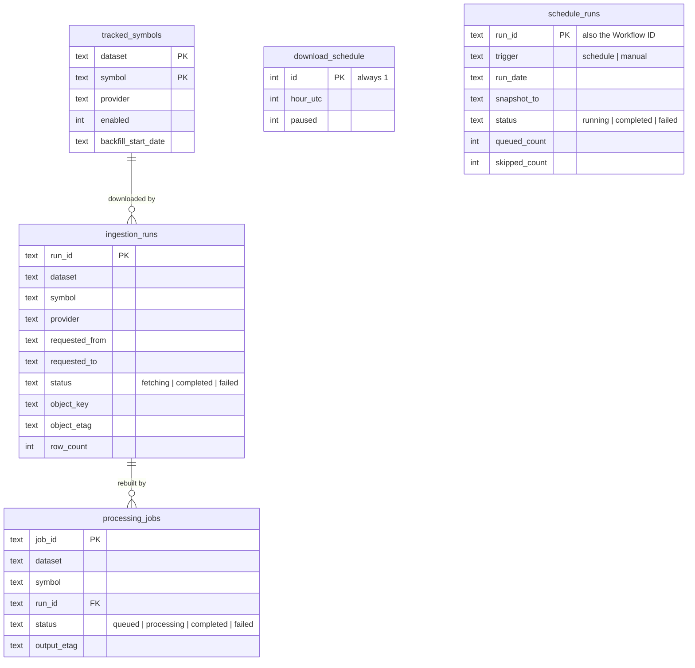
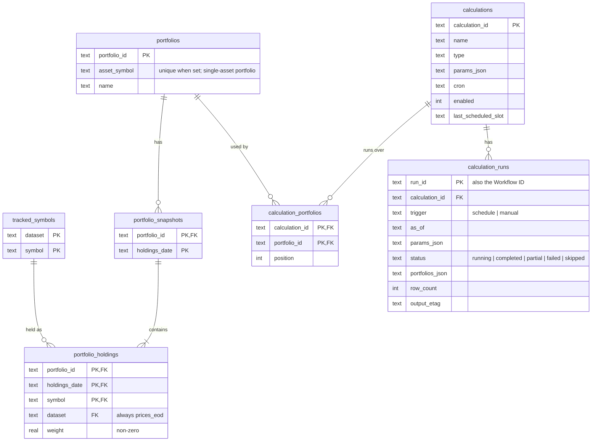
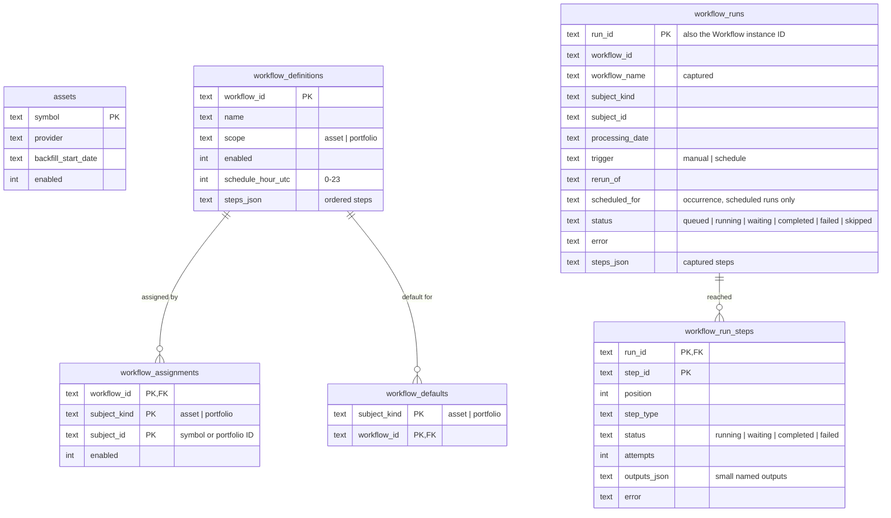

D1 (`data-service-market-data`) holds every piece of state: the universe, the
schedule, runs, jobs, portfolios and calculations. It holds **no market data
and no results**; those live in R2. Migrations are in `migrations/`.

## Market data

## Portfolios and calculations

Deleting a portfolio cascades to its snapshots and holdings; deleting a
calculation cascades to its portfolio links and runs. The foreign keys from
`portfolio_holdings` to `tracked_symbols` and from `calculation_portfolios` to
`portfolios` don't cascade, so a held symbol or a used portfolio can't be
deleted.

## Assets and workflow definitions

Steps, with their params and bindings, are JSON in `steps_json`; identity,
scope and schedule are ordinary columns. Deleting a definition, an asset or
(later) a portfolio removes its assignments in the same batch. The scope
update is conditional on there being no assignments, so a racing assignment
can't end up with the wrong kind of subject; the same goes for default links.

`workflow_defaults` lists, per subject kind, the definitions assigned to each
new subject. Creating an asset inserts its default assignments in the same
batch, before the asset row and only if the asset does not exist yet.
Scheduled runs record their daily occurrence in `scheduled_for`.

A run captures its definition's name and steps when it claims the
assignment, and has no foreign keys to definitions, assignments or assets, so
deleting configuration never deletes run history. Those deletions are
conditional on there being no active run. Step rows record each reached
step's attempts, error and small outputs; Cloudflare Workflows keeps the
checkpoints. Large step data lives in R2 under `runs/<runId>/`.

`dataset_publications` holds the current publication of each dataset per
subject (primary key `dataset, subject_kind, subject_id`): its processing
date, the producing `workflow_id`, `run_id` and `step_id`, the copied run
artifact, the format and schema, and the published object's ETag and size.
It is written after the object and replaced by the next publication. Like
runs it has no foreign keys, so deleting configuration keeps it.

## Concurrency rules

Partial unique indexes enforce the service's "one at a time" rules in the
database, so two Workers racing can't both win:

| Index                              | Rule                                                               |
| ---------------------------------- | ------------------------------------------------------------------ |
| `ingestion_runs_one_fetching`      | One `fetching` run per `(dataset, symbol)`                         |
| `processing_jobs_one_active`       | One `queued` or `processing` job per `(dataset, symbol)`           |
| `schedule_runs_one_per_day`        | One `schedule`-triggered run per `run_date`                        |
| `calculation_runs_one_running`     | One `running` run per calculation                                  |
| `workflow_runs_one_active`         | One `queued`, `running` or `waiting` run per assignment            |
| `workflow_runs_one_per_occurrence` | One run (queued or skipped) per assignment and schedule occurrence |
