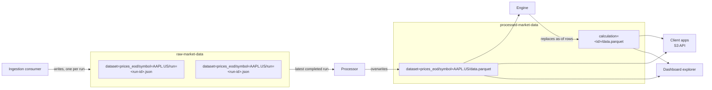

```txt
raw-market-data/dataset=<dataset>/symbol=<symbol>/run=<run-id>.json
raw-market-data/runs/<workflow-run-id>/<step-id>/<name>.<json|parquet>
processed-market-data/dataset=<dataset>/symbol=<symbol>/data.parquet
processed-market-data/calculation=<calculation-id>/data.parquet
```

## Raw bucket

Immutable, validated provider responses: one JSON envelope per ingestion run.
Nothing overwrites them. They are the input to every Parquet rebuild. See
[Ingestion](/docs/pipeline/ingestion/#raw-envelope) for the envelope format.

Workflow runs keep their temporary artifacts under `runs/<run-id>/`, one
object per step output, written again if the step is retried. Step outputs
reference them; they are not published data, and they expire (see
[Lifecycle](#lifecycle)). See [Workflow runs](/docs/workflows/runs/#artifacts).

## Processed bucket

What client apps read.

- **Canonical datasets.** One Parquet file per `(dataset, symbol)` at a stable
  key, rebuilt in full from the latest completed run. Switching provider
  doesn't move it. Workflow publication writes to the same key, so consumers
  read published workflow data where they always have; D1's
  `dataset_publications` records which run published it. See
  [Python operations and published datasets](/docs/workflows/datasets/).
- **Portfolio volatility.** The current Parquet result for a portfolio is
  `dataset=portfolio_volatility/portfolio=<ID>/data.parquet`. The workflow
  writes the result for its processing date and records its producer in D1.
- **Calculation results.** One Parquet file per calculation: the type's output
  columns plus `as_of` and `portfolio_id`, one set of rows per as-of date. They
  stay after the calculation is deleted.

## Reading the files

Apps read the files with any S3 client pointed at R2
(`https://<account-id>.r2.cloudflarestorage.com`) using a read-only R2 token.
For example, with polars:

```python
import polars as pl

prices = pl.read_parquet(
    "s3://processed-market-data/dataset=prices_eod/symbol=AAPL.US/data.parquet",
    storage_options={
        "aws_endpoint_url": "https://<account-id>.r2.cloudflarestorage.com",
        "aws_access_key_id": "…",
        "aws_secret_access_key": "…",
        "aws_region": "auto",
    },
)
```

The app's explorer reads the same files through `/app-api/datasets/:dataset/:symbol`
and `/app-api/calculations/:id/results`, which stream them from R2 with
their ETag, so the browser only downloads a file again after it changes.

## Lifecycle

Temporary run artifacts expire through one R2 lifecycle rule on the raw
bucket: objects under `runs/` are deleted 30 days after they were written.
Nothing else expires. The retained raw history
(`dataset=<dataset>/symbol=<symbol>/run=<id>.json`) is outside the prefix,
and published datasets are in the processed bucket, which has no rule. The
rule ignores whether a run is still active, so a run would have to wait or
retry for 30 days to lose its own artifacts.

The rule is checked in as `r2/raw-bucket-lifecycle.json`;
`test/r2-lifecycle.test.ts` checks its scope and duration. Apply it to each
raw bucket. `set` replaces every rule on the bucket, so list them first:

```sh
pnpm exec wrangler r2 bucket lifecycle list raw-market-data-dev
pnpm exec wrangler r2 bucket lifecycle set raw-market-data-dev --file r2/raw-bucket-lifecycle.json
pnpm exec wrangler r2 bucket lifecycle set raw-market-data --file r2/raw-bucket-lifecycle.json
```

R2 applies expiry in the background, so objects can outlive 30 days a little.

## Environments

|           | Production              | Dev                         |
| --------- | ----------------------- | --------------------------- |
| Raw       | `raw-market-data`       | `raw-market-data-dev`       |
| Processed | `processed-market-data` | `processed-market-data-dev` |
