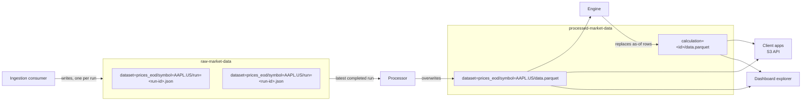

```txt
raw-market-data/dataset=<dataset>/symbol=<symbol>/run=<run-id>.json
processed-market-data/dataset=<dataset>/symbol=<symbol>/data.parquet
processed-market-data/calculation=<calculation-id>/data.parquet
```

## Raw bucket

Immutable, validated provider responses: one JSON envelope per ingestion run.
Nothing overwrites them. They are the input to every Parquet rebuild. See
[Ingestion](/docs/pipeline/ingestion/#raw-envelope) for the envelope format.

## Processed bucket

What client apps read.

- **Canonical datasets.** One Parquet file per `(dataset, symbol)` at a stable
  key, rebuilt in full from the latest completed run. Switching provider
  doesn't move it.
- **Calculation results.** One Parquet file per calculation: the type's output
  columns plus `as_of` and `portfolio_id`, one set of rows per as-of date. They
  stay after the calculation is deleted.

## Reading the files

Apps read the files with any S3 client pointed at R2
(`https://<account-id>.r2.cloudflarestorage.com`) using a read-only R2 token.
For example, with polars:

```python
import polars as pl

prices = pl.read_parquet(
    "s3://processed-market-data/dataset=prices_eod/symbol=AAPL.US/data.parquet",
    storage_options={
        "aws_endpoint_url": "https://<account-id>.r2.cloudflarestorage.com",
        "aws_access_key_id": "…",
        "aws_secret_access_key": "…",
        "aws_region": "auto",
    },
)
```

The dashboard reads the same files through `/dashboard/api/datasets/:dataset/:symbol`
and `/dashboard/api/calculations/:id/results`, which stream them from R2 with
their ETag, so the browser only downloads a file again after it changes.

## Environments

| | Production | Dev |
| --- | --- | --- |
| Raw | `raw-market-data` | `raw-market-data-dev` |
| Processed | `processed-market-data` | `processed-market-data-dev` |
