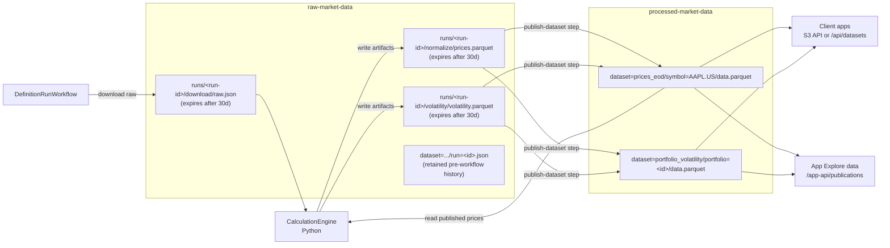

```txt
raw-market-data/runs/<workflow-run-id>/<step-id>/<name>.<json|parquet>
raw-market-data/dataset=<dataset>/symbol=<symbol>/run=<legacy-run-id>.json   # retained pre-workflow history
processed-market-data/dataset=prices_eod/symbol=<symbol>/data.parquet
processed-market-data/dataset=portfolio_volatility/portfolio=<portfolio-id>/data.parquet
```

## Raw bucket (`raw-market-data`)

Holds temporary workflow run artifacts under `runs/<runId>/<stepId>/<name>.<ext>`.
Each step writes its large outputs under a deterministic key derived from its
`runId` and `stepId`, so retrying a step overwrites the same object safely.
Step outputs carry small JSON artifact references (`id`, `format`, `schema`);
temporary artifacts are never consumer-facing published data.

Pre-workflow raw envelopes (`dataset=<dataset>/symbol=<symbol>/run=<id>.json`)
remain untouched outside the `runs/` prefix.

## Processed bucket (`processed-market-data`)

Holds current published Parquet datasets copied independently by
`publish-dataset`:

- **`prices_eod`** (asset scope):
  `dataset=prices_eod/symbol=<SYMBOL>/data.parquet` — preserves the stable path
  used by existing downstream consumers.
- **`portfolio_volatility`** (portfolio scope):
  `dataset=portfolio_volatility/portfolio=<PORTFOLIO_ID>/data.parquet`.

D1 `dataset_publications` records the processing date, producer
(`workflowId`, `runId`, `stepId`), schema, ETag, and byte size after the object
write succeeds. A failed download, normalization, or calculation leaves any
previous published dataset intact.

## Reading published datasets

Client apps can read Parquet objects either through the authenticated API
(`GET /api/datasets/:dataset/:kind/:subject/data`) or directly from R2 using an
S3 client with a read-only R2 token:

```python
import polars as pl

prices = pl.read_parquet(
    "s3://processed-market-data/dataset=prices_eod/symbol=AAPL.US/data.parquet",
    storage_options={
        "aws_endpoint_url": "https://<account-id>.r2.cloudflarestorage.com",
        "aws_access_key_id": "…",
        "aws_secret_access_key": "…",
        "aws_region": "auto",
    },
)
```

The app's Explore data page reads the same published datasets through
`/app-api/publications/:dataset/:kind/:subject/data`, revalidating by ETag
(`304 Not Modified`).

## Lifecycle

Temporary run artifacts expire automatically through **one R2 lifecycle rule**
on the raw bucket: objects under prefix `runs/` are deleted **30 days**
(`2,592,000` seconds) after they are written.

- No scheduled cleanup workflow, D1 artifact index, or reference counting is
  used.
- Retained pre-workflow raw history (`dataset=...`) does not match `runs/` and
  is never expired.
- Published datasets live in `processed-market-data`, which has no object
  expiration rule.

The rule is checked in at `r2/raw-bucket-lifecycle.json` and verified by
`test/r2-lifecycle.test.ts`. Apply it without removing existing multipart abort
rules:

```sh
pnpm exec wrangler r2 bucket lifecycle list raw-market-data-dev
pnpm exec wrangler r2 bucket lifecycle set raw-market-data-dev --file r2/raw-bucket-lifecycle.json
pnpm exec wrangler r2 bucket lifecycle set raw-market-data --file r2/raw-bucket-lifecycle.json
```

R2 processes expiry asynchronously in the background, so objects may remain
briefly past 30 days.

## Environments

|           | Production              | Dev                         |
| --------- | ----------------------- | --------------------------- |
| Raw       | `raw-market-data`       | `raw-market-data-dev`       |
| Processed | `processed-market-data` | `processed-market-data-dev` |
