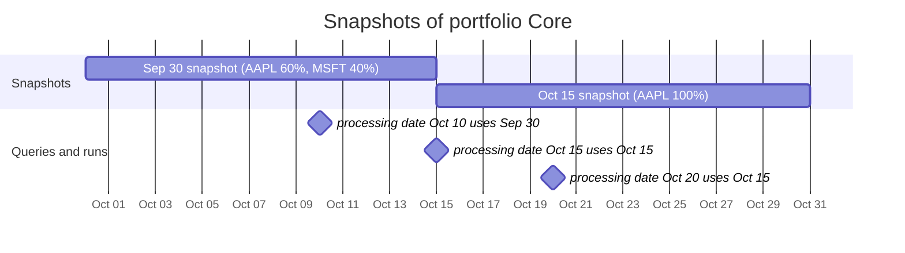
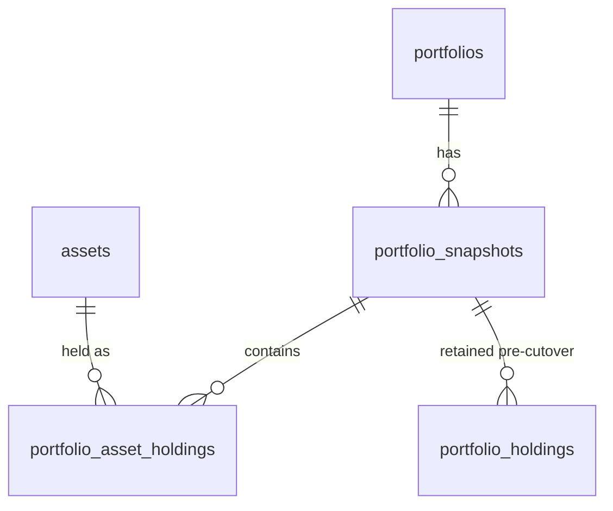

A **portfolio** is a name and a series of **holdings snapshots**. Each snapshot
is a `holdingsDate` and a list of `(symbol, weight)` exposures effective at the
close of that date. A snapshot stays in effect until the next dated snapshot
takes effect. The service stores complete dated snapshots, not trades or deltas.

## Which snapshot is in effect



- Querying the effective snapshot for date **D** (`GET /api/portfolios/:id/snapshots/effective?date=D`,
  or the `portfolio-holdings` workflow step) returns the latest snapshot dated
  **on or before D** (`422` / terminal failure if none exists).
- Querying an interval (`GET /api/portfolios/:id/snapshots?from=A&through=B`)
  returns the snapshot effective at `A` (if any) plus every snapshot dated
  strictly after `A` through `B`, inclusive.
- Portfolio workflows read current portfolio holdings when their holdings step
  runs; there is no historical snapshot pinning system.

## Rules

- **Registered assets only.** Every symbol in a new snapshot must exist in
  `assets` (disabled assets can be held). Unknown symbols return `400` with
  `symbols`.
- **Asset deletion protection.** Deleting an asset referenced by any snapshot
  (in `portfolio_asset_holdings` or retained pre-cutover `portfolio_holdings`)
  is rejected with `409`.
- **Weights.** Any finite non-zero numbers. Shorts (negative weights) and
  leverage are allowed, and weights do not need to sum to 1. Numerical
  operations (such as `calculate-portfolio-volatility` with
  `normalise_weights`) decide whether to normalize them.
- **One snapshot per date.** Adding a second snapshot for the same
  `holdingsDate` returns `409`.
- **Immutable snapshots.** Snapshots are added or deleted, never edited in
  place. To correct one, delete it and add it again.
- **Deleting a portfolio.** Blocked (`409`) while any workflow run for that
  portfolio is active (`queued`, `running`, or `waiting`). Once allowed,
  deletion removes the portfolio's snapshots and workflow assignments while
  preserving completed run history and published datasets.



## Retained pre-cutover compatibility

Pre-cutover portfolios created before the workflow migration may still store
historical holdings in `portfolio_holdings` (or carry a non-null `asset_symbol`
on retained legacy single-asset portfolios). `D1PortfoliosLive` reads both
`portfolio_asset_holdings` and `portfolio_holdings` via `UNION ALL`, writes all
new snapshots to `portfolio_asset_holdings`, and keeps retained single-asset
portfolios read-only (`409` on mutation). Creating new assets never creates
synthetic single-asset portfolios.

## API and defaults

```sh
# Create a portfolio, optionally with its first snapshot
curl -X POST "$URL/api/portfolios" \
  -H "Authorization: Bearer $MANAGEMENT_API_TOKEN" \
  -H 'Content-Type: application/json' \
  -d '{"name":"Core","snapshot":{"holdingsDate":"2026-09-30","holdings":[{"symbol":"AAPL.US","weight":0.6},{"symbol":"MSFT.US","weight":0.4}]}}'

# Query the effective snapshot or an interval
curl "$URL/api/portfolios/$ID/snapshots/effective?date=2026-10-10" \
  -H "Authorization: Bearer $MANAGEMENT_API_TOKEN"
curl "$URL/api/portfolios/$ID/snapshots?from=2026-10-01&through=2026-10-15" \
  -H "Authorization: Bearer $MANAGEMENT_API_TOKEN"

# Add or delete a snapshot
curl -X POST "$URL/api/portfolios/$ID/snapshots" \
  -H "Authorization: Bearer $MANAGEMENT_API_TOKEN" \
  -H 'Content-Type: application/json' \
  -d '{"holdingsDate":"2026-10-15","holdings":[{"symbol":"AAPL.US","weight":1}]}'
curl -X DELETE "$URL/api/portfolios/$ID/snapshots/2026-10-15" \
  -H "Authorization: Bearer $MANAGEMENT_API_TOKEN"
```

Creating a portfolio automatically assigns any
[default portfolio workflows](/docs/workflows/definitions/#defaults) in effect
at creation. The app's portfolio page (`/portfolios/:id`) displays dated
holdings, assigned workflows, published datasets, and recent runs.

To see a changing-holdings portfolio run end-to-end locally, run
`pnpm workflow:fixture` and inspect `.local/workflow-fixture/portfolio.json`
and `.local/workflow-fixture/portfolio-run.json`.

See [Management API](/docs/reference/api/#portfolios) for the full route list.
